# EasyQuiz

[](https://github.com/AnkingLin/EasyQuiz/actions/workflows/lint.yml)

**English** · [中文](README.zh-CN.md)

Questions are **plain Markdown**. EasyQuiz renders them as interactive cards in Obsidian's reading view,
grades your answers, and writes the attempt record **back into the note** — so your progress lives with
the questions, in your vault, under your own version control.

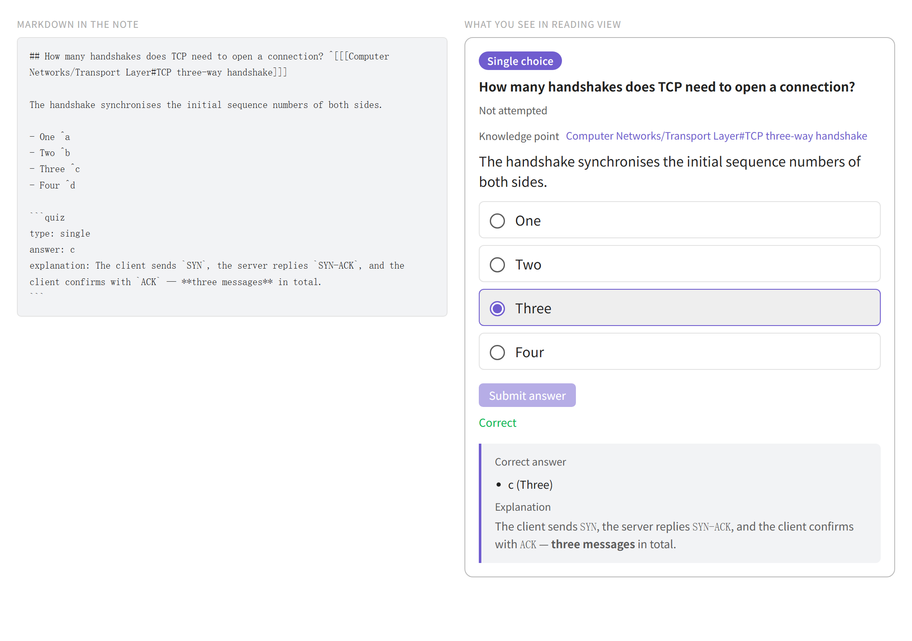

---

## What do you want to do?

| If you are wondering… | Read |
|---|---|
| How do I get one question working? | [Quick start](#quick-start) |
| What kinds of questions can I ask? | [The five question types](#what-kinds-of-questions-can-i-ask) |
| What exactly goes in the note? | [How exactly do I write a question?](#how-exactly-do-i-write-a-question) |
| How do I practise a whole question bank? | [How do I practise a whole question bank?](#how-do-i-practise-a-whole-question-bank) |
| How do I tie a question back to my notes? | [How do I tie a question to my notes?](#how-do-i-tie-a-question-to-my-notes) |
| How do I practise one question inside another note? | [How do I embed a question in another note?](#how-do-i-embed-a-question-in-another-note) |
| Where do my answers and scores end up? | [Where do my answers go?](#where-do-my-answers-go) |
| Can I use it in English or Chinese? | [Can I use the interface in my language?](#can-i-use-the-interface-in-my-language) |
| What changed in the latest version? | [What's new](#whats-new) |
| Something looks wrong — what now? | [Troubleshooting](#troubleshooting) |
| How do I build or contribute? | [Development](#development) |

## Quick start

1. Install the plugin (see [Installing into a vault](#installing-into-a-vault)) and enable it.
2. Create a note, tick **quiz** on it with frontmatter, and write one question:

   ````markdown
   ---
   quiz: true
   ---

   ## TCP 建立连接需要几次握手？ ^[[[计算机网络/传输层#TCP 三次握手]]]

   - 一次 ^a
   - 两次 ^b
   - 三次 ^c
   - 四次 ^d

   ```quiz
   id: tcp-handshake
   type: single
   answer: c
   ```
   ````

3. Switch to reading view: the `quiz` block becomes a card. Answer it and submit — the record is written
   back into the note.

   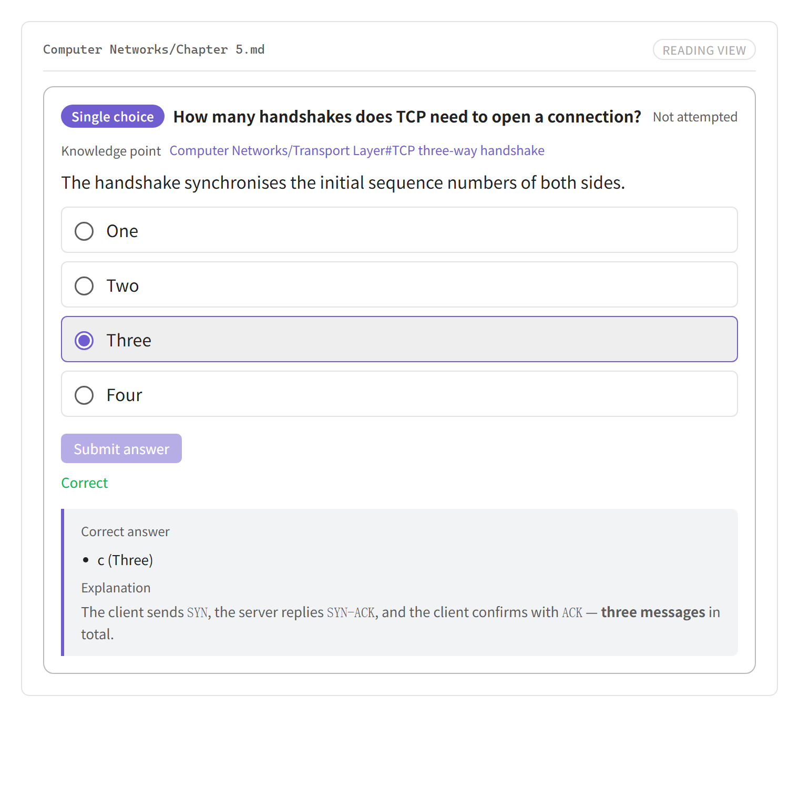

4. Run **Open practice window** in the command palette (or click the ribbon icon) to practise a whole
   question bank, or several at once.

That is the whole loop. Everything below answers one question at a time; read only what you need.

## What kinds of questions can I ask?

Five types, and the type always comes from the `type` field — it is **never guessed from the shape of the
content**. Pick one:

| Type | You write | The card gives you |
|---|---|---|
| `single` | A Markdown list, one correct anchor | Click one option |
| `multi` | A Markdown list, several correct anchors | Click several options |
| `match` | A Markdown table (its row order *is* the answer) | Click to connect adjacent columns |
| `blank` | `==highlights==` in the prose | Type into the gaps, inline |
| `essay` | Free prose + a collapsed reference answer | Write, then self-assess |

### Single choice

Options are a native list. Answers are tied to **anchors** (`^a`) rather than positions, so when you write
anchors yourself, inserting, deleting, or reordering an option never misaligns your records. Anchors are
optional: if no option has one, options are numbered `a`, `b`, `c`… from top to bottom, so `answer: c` still
means the third option. If only some options have anchors, only those appear on the card; the unanchored
ones are hidden.

````markdown
## TCP 建立连接需要几次握手？ ^[[[计算机网络/传输层#TCP 三次握手]]]

- 一次 ^a
- 两次 ^b
- 三次 ^c
- 四次 ^d

```quiz
id: tcp-handshake
type: single
answer: c
explanation: 三次握手用于同步双方的初始序列号。
```
````

After submitting, the correct option is outlined and the explanation appears underneath — nothing is
hidden behind a separate answer key:


Stems, options and explanations are all drawn by Obsidian's own renderer, so `**bold**`, `` `code` ``,
`![[image.png]]` embeds and `$formula$` work on the card and in the practice window.

Both themes are supported, since the card is drawn with Obsidian's own theme variables:

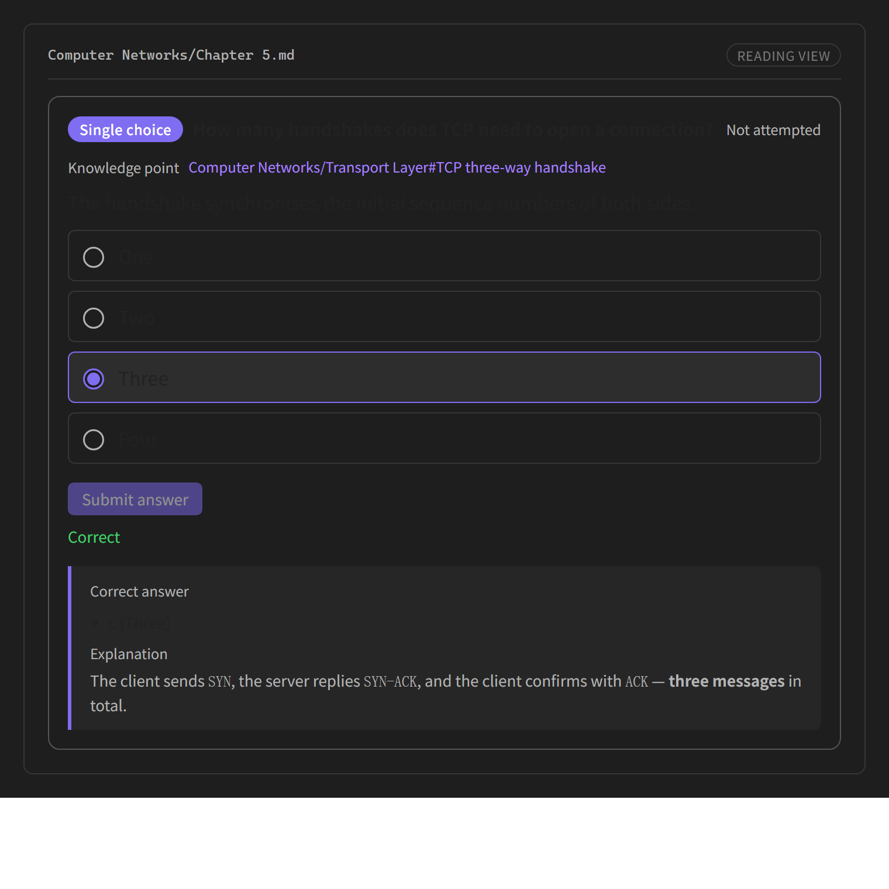

### Multiple choice

Same shape, but `answer` is a list; the anchor rules are the same as for single choice. Getting it partly
right counts as wrong, and the review lists every correct anchor so you can see what you missed:

````markdown
## 下列哪些属于传输层协议？ ^[[[计算机网络/传输层#传输层协议]]]

- TCP ^a
- UDP ^b
- IP ^c
- ICMP ^d

```quiz
type: multi
answer: [a, b]
shuffle: true
```
````

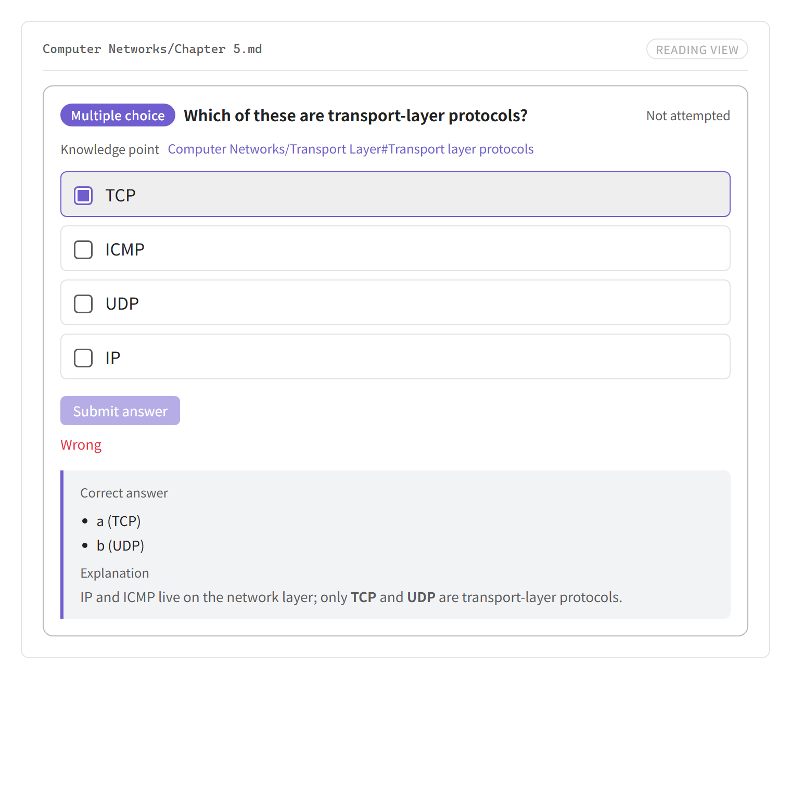

### Matching

Written as a **multi-column table**. The table's original row order *is* the correct answer, and every
column is shuffled independently at practice time, so the order never gives it away.

````markdown
## 将协议与其默认端口配对 ^[[[计算机网络/应用层#常见默认端口]]]

| 协议 | 端口 |
| --- | --- |
| HTTP | 80 |
| HTTPS | 443 |
| SSH | 22 |

```quiz
type: match
```
````

Click an item on the left, then its partner on the right, and the connection is drawn between them:

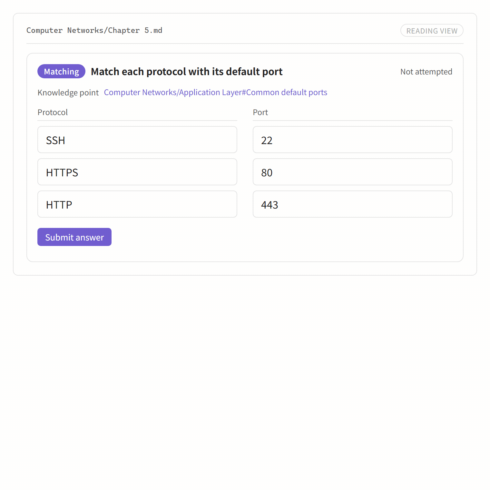

- **Only adjacent columns connect.** A row `A | B | C` means the links `A–B` and `B–C`; clicking column 1
  and then column 3 is rejected.
- **Direction does not matter** — left-then-right and right-then-left make the same link.
- **Order is shuffled**, and duplicate entries inside one column are merged.
- **Several items may point at the same item** (merged options), e.g. `MySQL` and `PostgreSQL` both
  linking to `关系型`.
- Adding or reordering rows does not invalidate records: an item's key depends only on its column and text.
- The table itself is not rendered — the board replaces it, so nothing appears twice.

### Fill in the blank

Mark the answers inside the prose. The blank anchor `^bN` is **optional** — leave it out and blanks are
numbered in order of appearance.

````markdown
## 补全 TCP 首部字段 ^[[[计算机网络/传输层#TCP 首部]]]

TCP 首部的最小长度是 ==20== 字节，其中 ==序号== 字段用于标识本报文段的数据的第一个字节。

```quiz
type: blank
blanks:
  b1: { accept: ["20", "20字节", "二十"] }
  b2: { ignoreCase: true }
```
````

The gaps are rendered **inline in the stem** and grow as you type, so the sentence stays readable while
you fill it in:

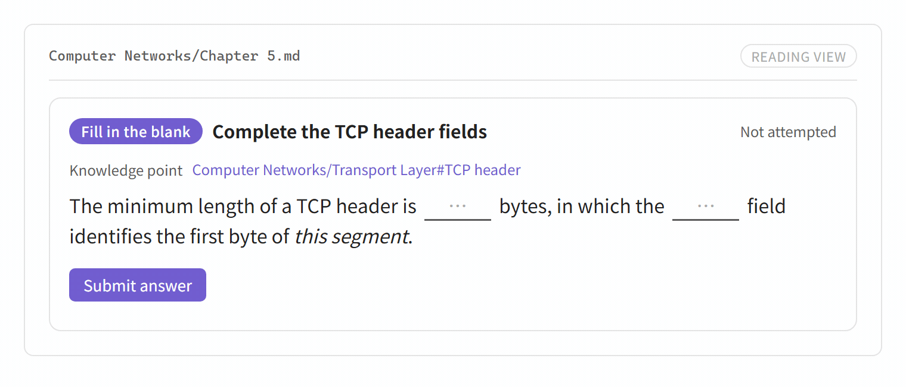

After submitting, the answers are written into the gaps in place:

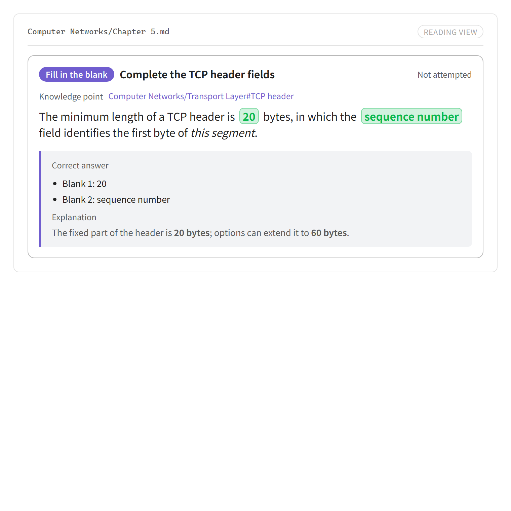

- The marker is configurable: `==answer==` (default), `**answer**`, or both.
- Markers inside code blocks and inline code are ignored, so you can write `==like this==` as an example.
- Blanks not listed under `blanks` use strict matching (surrounding whitespace is ignored).
- The answer text never appears in the stem before you submit.

### Short answer

No fixed answer. The body is free prose, and a reference answer goes in a **collapsed callout** so it does
not spoil the question:

````markdown
## 简述 TCP 与 UDP 的主要区别。 ^[[[计算机网络/传输层#TCP 与 UDP 对比]]]

从连接、可靠性、传输方式与适用场景四个方面作答。

> [!question]- 参考答案
> TCP 面向连接、可靠、字节流；UDP 无连接、不保证可靠、报文边界保留。

```quiz
type: essay
```
````

Grading is **self-assessed**: after writing, mark it as mastered or not mastered.

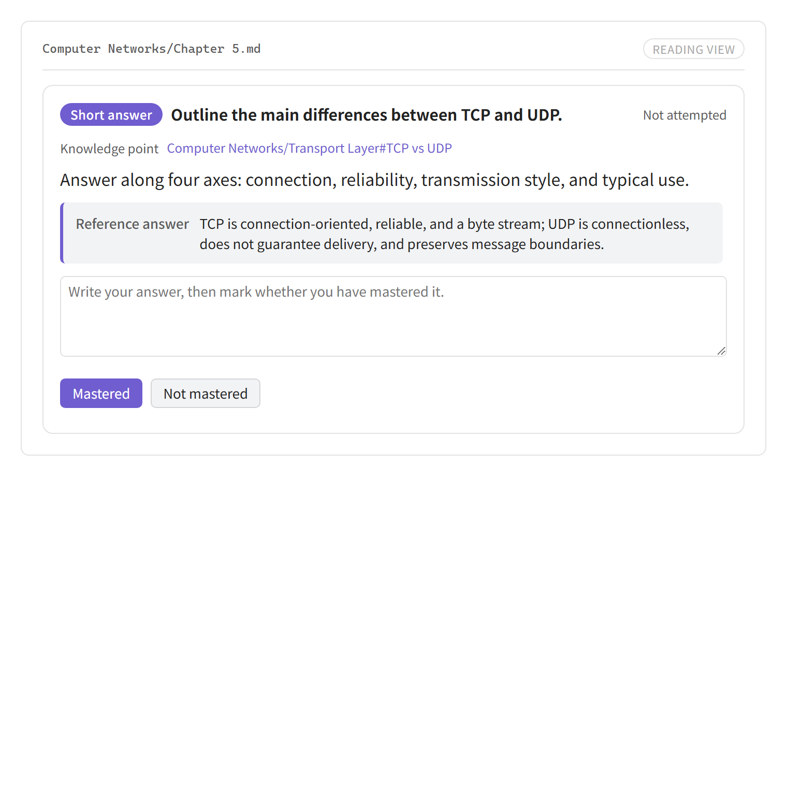

### What if I get the type wrong?

Nothing is guessed, and nothing else breaks. Each problem degrades **only its own question** into a
diagnostic card that names the line and the fix:

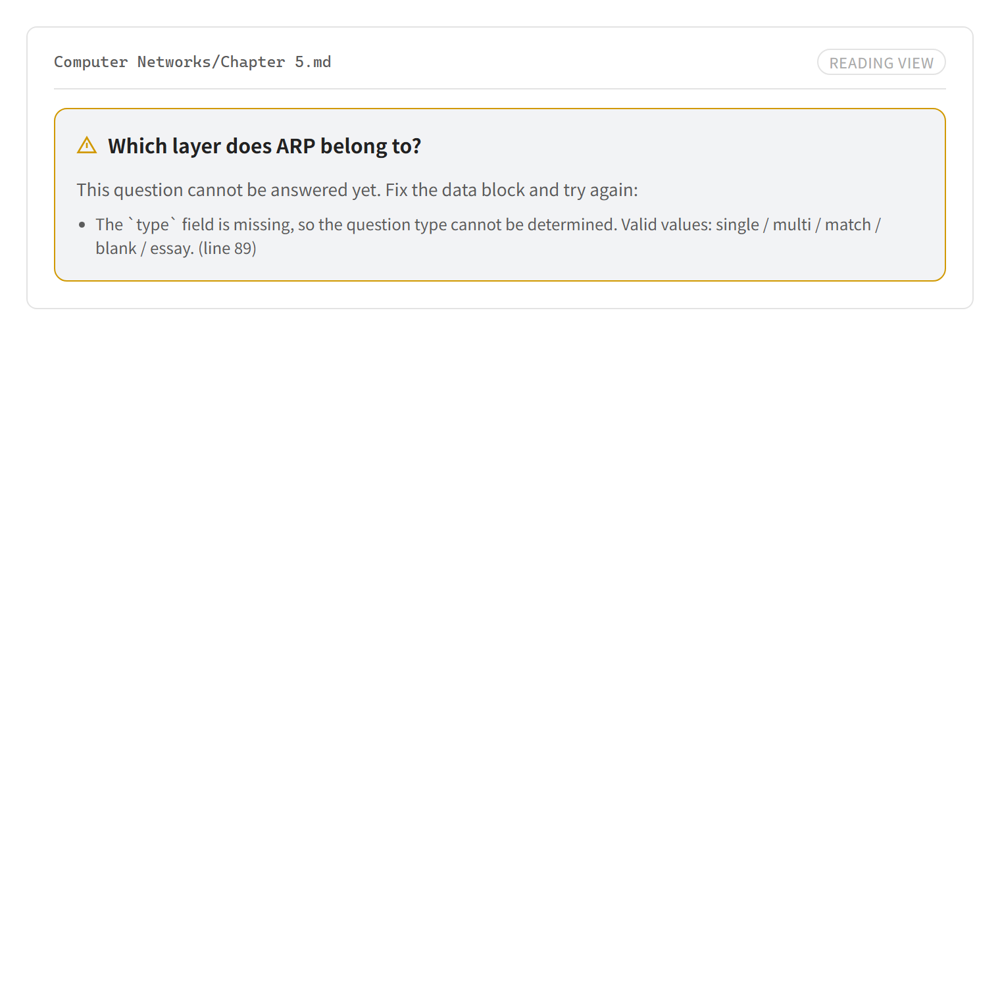

| Situation | Behaviour |
|---|---|
| `type` missing | Degrade; explain that `type` is required |
| `type` value invalid | Degrade; list the five valid values |
| `type: single`/`multi` but no list | Structure mismatch; not answerable |
| `type: match` but no table, or fewer than 2 columns | Structure mismatch |
| `type: blank` but no `==…==` | Structure mismatch |
| Some choice options have no anchor | Those options are hidden; the anchored options stay answerable |
| Duplicate option anchors | Not answerable |
| `answer` points at a nonexistent anchor | Not answerable |
| YAML parse error | Degrade; show the raw error |

## How do I practise a whole question bank?

**Open practice window** (or the ribbon icon) opens the window in the right sidebar, with three pages, so a
whole session never leaves it. The same window can also be opened in a main-area tab or in its own window —
see **Open practice window in a new tab** / **Open practice window in a new window** in the command palette.
Each location keeps one window of its own, so a sidebar session and a tab session can run side by side.

### 1. Question-bank list

Every question-bank file in the vault, grouped by folder, each with its data on the same row: total
questions, answerable, how many need fixing, per-type counts, attempts, accuracy, and the date of the last
attempt. A file that fails to parse reports its own error without breaking the list.

With a large library, this page gives you three ways to narrow it down:

- **Search** — filters by file name or path as you type, and reports **how many files matched**. Searching
  never touches the files you have already ticked.
- **Fold folders** — click a folder header to collapse or expand that group; **Collapse all** / **Expand
  all** do every group at once. The folded state is saved with the workspace.
- **Tick a whole folder** — every folder header carries a checkbox that selects or clears the group, and
  shows a half-tick when only part of it is selected.

Tick one or more files — or **Select all answerable** (which applies to the current search results) — to
practise them together:

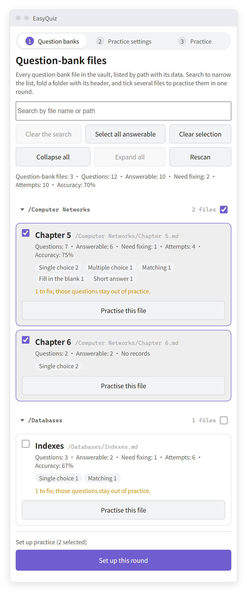

### 2. Practice settings

Decide how to draw this round, and see **how many questions it will actually ask before you start**:

- **In order** — every candidate, in file order.
- **Random sample** — shuffle and take N (0 or empty = everything).
- **Only wrong answers** — keep questions whose last attempt was wrong.
- **Question types** — any subset; nothing ticked means all types.
- **Shuffle** — randomise question order and choice-option order. Option order is derived from the round's
  seed, so it stays put while you review an answer or step between questions, and only re-shuffles when a
  new round starts. Grading is by anchor, so a shuffled option never changes what counts as correct.

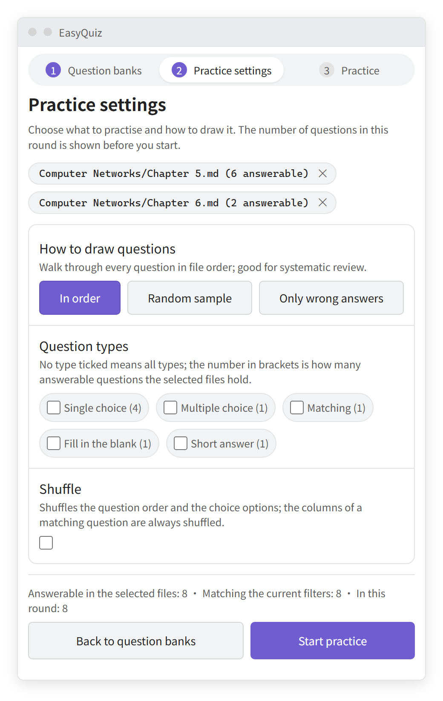

Degraded questions never enter a session, so a broken question can't quietly eat a slot.

### 3. Practice

One question at a time, rendered by the same card UI as in the note, with a sticky progress bar, a
correct/wrong tally, and previous/next (plus a jump box on longer rounds). Submitting grades through the
same service, so records are written back exactly as in reading view:

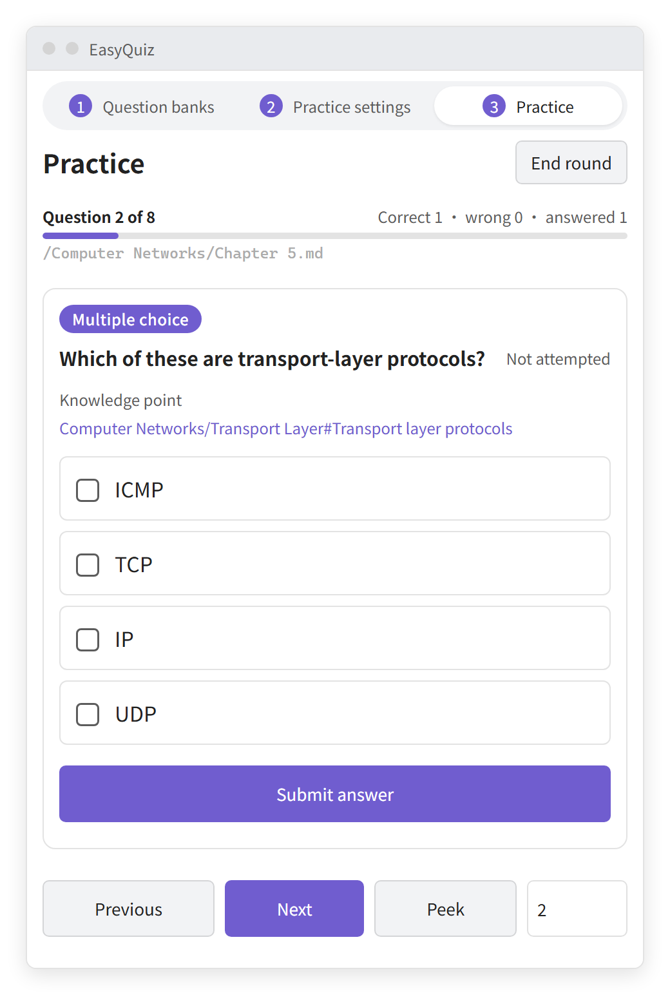

- **Peek** reveals the answer without scoring it.
- The last page summarises the round, lists what you got wrong, and offers **Retry wrong only**.

Because answers are keyed to file path + question id, a round survives editing a file: the window re-parses
a bank when it changes, and again after each write-back.

## How do I tie a question to my notes?

End the stem heading with `^[[[]]]` — `^[`, an Obsidian wikilink, `]`:

```markdown
## TCP 建立连接需要几次握手？ ^[[[计算机网络/传输层#TCP 三次握手]]]
```

- The `^[ … ]` wrapper marks the link as an annotation of the stem rather than ordinary question text. The
  `[[…]]` inside is a real wikilink: it renders as a link, and the question-bank note appears in the
  target's backlinks panel — visible as the **Knowledge point** row on the card.
- The parser **strips it from the displayed title and from the derived id**, so retargeting a link never
  disconnects accumulated `stats` / `history`. The target is available as `QuizQuestion.knowledgeLink`.
- `rev` (the stem hash) is computed from the stem body, not the heading, so **relinking a question does
  not mark its records as "stem changed"**.
- Only a trailing `^[[[]]]` counts. The older two-bracket form `^[[…]]` is still recognised. Write a plain
  `[[]]` inside the stem body when you want an inline link in the question text; only the heading link is
  stripped.
- Links are optional — a question without one simply has `knowledgeLink: null`.

The full authoring convention, including the five question types and the review checklist, lives in
[`skills/easyquiz-authoring/SKILL.md`](skills/easyquiz-authoring/SKILL.md). It is written for AI agents
authoring or reviewing a bank, and its examples are executed by the test suite, so the documented
skeletons are guaranteed to parse.

## How do I embed a question in another note?

Reference a question by its stem heading and it renders as a **real, answerable card** right there:

```markdown
![[计算机网络/第三章#TCP 建立连接需要几次握手？]]
```

- The subpath is the **stem heading text, with the trailing `^[[[]]]` knowledge link left out**.
- Records still belong to the bank: answering in an embedded copy writes back to the bank note, exactly as
  in reading view there. The **Knowledge point** link on the card still points at the knowledge note.
- Use it to build a review note, a lecture handout, or a mock exam out of questions you already wrote —
  without copying the question text (and therefore without letting the copies drift apart).
- A subpath that does not name a stem heading is left completely alone, so ordinary embeds such as
  `![[Some note#Some section]]` keep behaving exactly as Obsidian renders them.
- Block references (`![[bank#^block-id]]`) and footnote references are not questions and are also left alone.

This is deliberately **not** Obsidian's built-in heading embed. Two reasons: a plain embed would show the
option list and the raw `quiz` data block instead of a card, and Obsidian's heading lookup normalises
punctuation — which the trailing `^[[[knowledge link]]]` derails, making it silently fall back to rendering
the **entire** bank file. EasyQuiz recognises the embed itself and replaces it with a card.

## How exactly do I write a question?

### Question bank file

A file is treated as a question bank when any of these hold:

1. frontmatter `quiz: true` (**preferred** — keeps the body clean);
2. a file-level `#quiz` tag (frontmatter tags or an inline tag);
3. a configured path glob matches (e.g. `题库/**`).

````markdown
---
quiz: true
schemaVersion: 1
title: 计算机网络 · 第三章
tags:
  - quiz/net
---

# 计算机网络 · 第三章
````

### Anatomy of a question

- A question spans from its stem heading to the **next heading of the same or higher level**.
- The heading text is the question title; end it with `^[[[]]]` to record the source knowledge point.
- The `quiz` block is **required**: the question type comes from its `type` field.
- Put the data block at the end of the question, or right after the heading — both are equivalent.

**Stem heading levels.** A deeper heading is treated as a sub-heading of the current question **only if a
shallower heading appears later** in the file; otherwise it is itself a question stem. In practice: use a
single heading level per file (default H2).

### Metadata fields

| Field | Required | Notes |
|---|---|---|
| `type` | **yes** | `single` / `multi` / `match` / `blank` / `essay`. The *only* thing that decides the type. |
| `id` | no | Stable identifier; derived from the heading text (with the `^[[[]]]` knowledge link excluded) when omitted. |
| `answer` | type-dependent | `single`: `c`; `multi`: `[a, b]`; `blank` and `match` and `essay`: not used. |
| `blanks` | no | Per-blank matching rules: `strict` / `ignoreCase` / `regex` / `accept`. Keys are blank anchors. |
| `shuffle` | no | Shuffle this question's choice options. Default `false`; `match` is always shuffled. |
| `explanation` | no | Explanation text, rendered as Markdown (bold, inline code, images, formulas). May also be written inline as a `> [!note]- 解析` callout. |
| `score` | no | Points, default 1. |
| `stats` | no | **Written by the plugin**: `attempts` / `correct` / `lastResult` / `lastAt`. |
| `rev` | no | **Written by the plugin**: stem hash, used to detect edits. |

`stats` and `rev` are maintained automatically — **authors never write them**.

### Anchors

Choice options and blanks use Obsidian's native block-ID syntax `^id`, so answers are tied to anchors
rather than positions:

````markdown
- A option ^a
- B option ^b

The minimum TCP header length is ==20== ^b1 bytes.
````

Choice-option anchors are optional. With none at all, options are numbered `a`, `b`, `c`… by position; with
only some, the unanchored options are hidden from the card. Write explicit anchors when a question's options
may be reordered and its records must stay attached to the same option.

Matching tables do **not** use anchors: a `^id` in a table cell is literal text, and row-level anchors are
unsupported. Match records are keyed by row-content hash plus row index, so editing a table marks the
affected records as "stem changed" rather than silently discarding them.

### Matching details

- A table is only read as a matching question when `type: match`; tables in other question types are
  ordinary prose and are not graded.
- **An item can carry more than one line per neighbouring column pair.** Clicking a pair that is already
  connected removes that line, so reconnecting means removing the old line first.
- Clicking a connected item only selects it; it does not silently drop its line.
- **Duplicate entries are merged**: within one column, items with the same text appear once.
- Columns whose headers are duplicated or empty get distinguishable names (e.g. `层级（第 2 组）`).
- **Multiple columns** chain through the table, and all adjacent pairs must be matched:

  ````markdown
  | 协议 | 端口 | 层级 |
  | --- | --- | --- |
  | HTTP | 80 | 应用层 |
  | IP | 0 | 网络层 |
  ````

- **One cell is one entry.** A cell's text is kept as written, so `MySQL / PostgreSQL` is a single item
  named `MySQL / PostgreSQL`, not two. To make one item answer for several, repeat the row — the shared
  text is merged into one node, and that node keeps every line it needs:

  ````markdown
  | 数据库 | 类型 |
  | --- | --- |
  | MySQL | 关系型 |
  | PostgreSQL | 关系型 |
  | Redis | 键值型 |
  ````

  This yields `MySQL`, `PostgreSQL`, `Redis` in the first column and `关系型`, `键值型` in the second.
  `关系型` appears once but carries two lines, one to `MySQL` and one to `PostgreSQL`.
- A table needs at least 2 columns, otherwise the question degrades with a warning.

### Blank matching rules

- Each marked span is one blank; the number of blanks comes from the question body.
- Write an explicit anchor only when you need to reference that blank from `blanks`:

  ````markdown
  最小长度是 ==20== ^len 字节。
  ````

- Anchors you don't write are numbered `b1`, `b2`, … by position; mixing explicit and automatic anchors in
  one question is fine.

## Where do my answers go?

Everything is written into the question's own `quiz` block, so it travels with the note:

```yaml
type: single
answer: c
stats: { attempts: 12, correct: 9, lastResult: correct, lastAt: 2025-01-01T10:00:00Z }
rev: 8f3c1a
history:
  - { at: 2025-01-01T10:00:00Z, result: correct, ms: 4200 }
  - { at: 2025-01-01T09:58:11Z, result: wrong, answer: ["b"], ms: 6100 }
```

- `stats` is the never-truncated summary that powers accuracy figures.
- `history` is capped by the setting above; the oldest entries are dropped first.

Write-back rules:

1. Only `stats`, `history`, and `rev` are touched — everything else is preserved byte for byte.
2. Writes go through `Vault.process` (atomic read-modify-write); the block is re-located from the fresh
   file content, so edits made meanwhile are not overwritten.
3. The patched block is re-validated as YAML first; if validation fails the write is skipped rather than
   risking a corrupted note.

### Known limitations

| Limitation | Impact | Mitigation |
|---|---|---|
| Every answer rewrites the note | Git users see `git status` churn; Sync may conflict | Writes can be turned off in settings |
| Detail list must be capped | Full attempt history is not kept | `stats` is never truncated; raise the cap |
| Notes in a non-writable vault | Records cannot be persisted | The attempt still grades in the UI |

## Can I use the interface in my language?

Yes — the interface ships in **English and Chinese**. There is no separate translation file to install:
both message tables are bundled, and the plugin picks one when it loads, and again the moment you change
the setting.

- **Follow Obsidian** (the default) reads Obsidian's own language and uses Chinese for a Chinese variant
  (`zh`, `zh-CN`, `zh-TW`, …), English for everything else.
- The **Interface language** setting overrides that choice.
- Switching language re-renders the practice window, the settings tab, and the quiz cards already open in
  reading view immediately. Command names in the palette and the ribbon tooltip are registered when the
  plugin loads, so they change after a **reload**.
- Quiz **content** is never translated: a question written in Chinese stays Chinese, and the same goes for
  `explanation`, option text, and everything else inside the note. Only interface text follows the setting.

## What else can the plugin do for me?

| Command | What it does |
|---|---|
| Open practice window | Opens the practice window in the right sidebar (also on the ribbon icon) |
| Open practice window in a new tab | Opens the practice window as a main-area tab |
| Open practice window in a new window | Opens the practice window in its own window (desktop only) |
| Insert question | Opens a dialog to build a question skeleton and inserts it at the cursor |
| Validate current question bank | Reports how many questions are answerable vs. need fixing |
| Refresh quiz view | Forces the reading view to re-render the quiz blocks (also happens after edits) |

The insert dialog is also on the editor context menu (**right-click → Insert question**, Markdown notes
only). It asks for the type and the stem title, previews the Markdown before writing, and follows the
interface language — so an English UI inserts English skeletons:

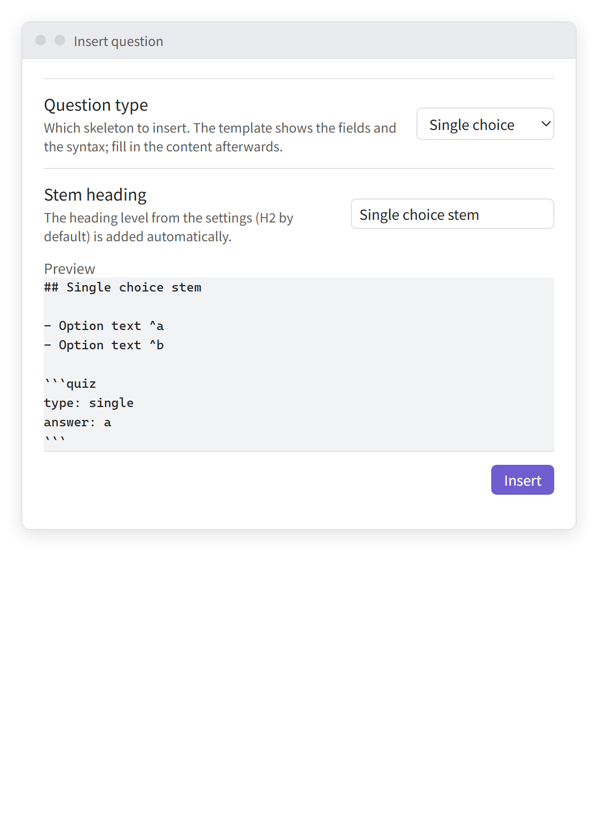

Question banks can also be started straight from the **file explorer**: pick **⋯ → Practise this question
bank** next to a bank file in the file list or the file tree, and the practice window opens **directly on
that bank's practice settings** — no need to open the window and then hunt for the file. The item only
appears for Markdown question banks; multi-selections and other files are left alone.

## Settings

| Setting | Default | Notes |
|---|---|---|
| Interface language | Follow Obsidian | `Follow Obsidian`, `English`, or `中文` |
| Block language | `quiz` | Change if it clashes; reload Obsidian afterwards |
| Blank marker | `==` | Which Markdown marker defines a blank: `==answer==`, `**answer**`, or both |
| Stem heading level | H2 | Decides which headings are questions |
| Question-bank path globs | empty | One per line, e.g. `题库/**` |
| Write records back | on | Turn off to grade in the UI only, leaving notes untouched |
| Per-question history cap | 10 | Records live in the note, so the detail list must be capped; `0` keeps only the summary |

## Installing into a vault

1. Create `<Vault>/.obsidian/plugins/easy-quiz/`.
2. Copy `main.js`, `manifest.json`, and `styles.css` into it.
3. Reload Obsidian and enable the plugin under **Settings → Community plugins**.

## What's new

### 1.0.10

- **Markdown everywhere on the card.** Stems, options, explanations and matching cells are rendered by
  Obsidian, so bold, italic, inline code, `![[image]]` embeds and `$formula$` all show up on the card and
  in the practice window.
- **A tighter practice page on phones.** The progress row no longer repeats the question title, and the
  header, banner and buttons take less vertical room.

### 1.0.9

- **Practise anywhere.** The practice window is no longer tied to the right sidebar: **Open practice window
  in a new tab** puts it in the main area, and **Open practice window in a new window** opens a popout on
  desktop. Each location keeps its own round, so a sidebar session and a tab session can run side by side.
- **A progress banner that stays put.** The banner on the practice page is pinned to the top of the
  scrolling area, so the score and position stay visible while you work through a long round.
- **Anchors are optional.** If no choice option has an anchor, options are numbered `a`, `b`, `c`… by
  position. If only some have anchors, the rest are hidden.

The plugin shows these notes once per version. Older releases are listed in
[GitHub releases](https://github.com/AnkingLin/EasyQuiz/releases).

## Troubleshooting

| Symptom | Cause | Fix |
|---|---|---|
| The `quiz` block shows as a plain code block | The note is not detected as a question bank, or the block is not under a stem heading | Add `quiz: true`, check the heading level matches **Stem heading level** |
| The card appears but **Submit** does nothing | The question degraded (a warning is shown above the data block) | Fix what the warning names — usually `type`, a duplicate anchor, or a YAML error |
| Editing a question leaves the old card on screen | Reading view does not re-render code blocks on its own | The plugin refreshes automatically; otherwise run **Refresh quiz view** |
| Records stopped accumulating after a rename | The `id` was derived from the old heading text | Give the question an explicit `id`; records are keyed by file path + question id |
| A `quiz` block is ignored entirely | It sits outside any heading that counts as a question | Move it under a stem heading |
| The data block language was changed | The processor is registered at load time | Reload Obsidian |
| Another plugin's `quiz` snippet stopped rendering | This plugin claimed the `quiz` block language | Change **Block language** in settings, then reload |

## Development

```bash
npm install
npm run dev        # watch src/main.ts, rebuild main.js on change
npm run build      # tsc type check + production bundle
npm test           # bundle and run the test suite (396 cases)
npm run typecheck  # type check only
npm run lint       # eslint (eslint-plugin-obsidianmd)
npm run assets     # regenerate the screenshots and GIFs used by the READMEs
```

The suite has two layers:

- **Pure logic** (`parser`, `stem`, `grade`, `writeback`, `match-board`, `insert`, `session`): plain node, no DOM.
- **DOM** (`tests/quiz-match-dom.test.ts`, `tests/quiz-insert-modal.test.ts`, `tests/quiz-practice-view.test.ts`,
  `tests/quiz-knowledge-link.test.ts`, `tests/quiz-file-menu.test.ts`, `tests/quiz-i18n.test.ts`):
  renders the real card and board through `renderQuizCard` under jsdom and clicks its nodes, so click handling,
  line targets, per-column isolation, the `MarkdownRenderer` contract and the knowledge-point link are checked
  rather than assumed; the insert dialog is opened through `InsertQuestionModal` and its controls are driven;
  the practice window is opened through `PracticeView` and walked through all three of its pages — including
  the list's search, folder folding and per-folder selection; and the file-explorer menu is driven through
  its real event handlers.
  `tests/dom.ts` installs the Obsidian-style DOM helpers (`createDiv`, `addClass`, …) and
  `tests/obsidian-stub.ts` stands in for the type-only `obsidian` package.

`tests/quiz-skill-doc.test.ts` closes the loop between documentation and code: it reads
`skills/easyquiz-authoring/SKILL.md`, extracts every marked example, and feeds it to the real parser and
grader. A documented skeleton that cannot be answered fails the suite.

`tests/quiz-i18n.test.ts` covers the other direction: the two message tables must expose the same keys and
the same `{placeholders}`, and the English interface is rendered for real (card, parser warning, practice
window) rather than only looked up.

### Regenerating the README images

Every screenshot and GIF in this document is produced by `npm run assets`, which runs the plugin's real
code in a headless browser:

- the fixtures in `tools/readme-assets/browser/fixtures.ts` are parsed by the real `parseQuizFile`;
- the cards are drawn by the real `renderQuizCard`, the window by the real `PracticeView`, and the dialog
  by the real `InsertQuestionModal`;
- the styling comes from the plugin's own `styles.css`, over a small approximation of Obsidian's default
  theme (`tools/readme-assets/theme.css`).

So the images show genuine renderer output, but note the honest caveat: they are **not screenshots of a
real Obsidian window**. The surrounding chrome (window frame, note header) is a stand-in, and the GIFs are
frame sequences the generator produces by driving real click/type events — not a screen recording. Output
goes to `docs/assets/<en|zh>/`, so each README shows its own interface language.

### Source layout

```
src/main.ts          plugin entry: code-block processor, commands, view registration, settings tab
src/parser.ts        question-bank parser (pure logic, no obsidian import)
src/types.ts         question model and parse-result types
src/stem.ts          stem preprocessing: strips what the interactive controls render (pure logic)
src/embed.ts         `![[bank#question]]` embed matching: src parsing, heading keys, question lookup (pure logic)
src/plain-text.ts    display-only plain text for option/answer text in review notes (pure logic)
src/grade.ts         grading for the five question types (pure logic)
src/writeback.ts     record write-back: only stats/history/rev, validated before writing
src/hash.ts          stem hash (rev change detection)
src/match-board.ts   matching board state machine: adjacent-column links (pure logic)
src/session.ts       practice planning: file summaries, filtering, sampling, progress (pure logic)
src/runtime.ts       Obsidian adapter: file detection, dependency injection, atomic writes
src/view.ts          practice card rendering (including the header's knowledge-point link)
src/practice-view.ts practice window: question-bank list / practice settings / practice
src/whats-new.ts     update notes by version and the upgrade check (pure logic)
src/whats-new-modal.ts the one-time What's new dialog
src/insert.ts        question templates and insertion positioning (pure logic)
src/insert-modal.ts  insert-question dialog and the editor write
src/file-menu.ts     the file explorer menu entry that starts practising a bank
src/labels.ts        question-type labels and default stem titles, shared by card/dialog/window (pure logic)
src/i18n/            English/Chinese message tables and the language state (pure logic)
skills/              agent-facing authoring spec (SKILL.md), examples verified by the test suite
tests/               parser / stem / grading / write-back / insert / session tests, the window tests, a fixture
tools/readme-assets/ README screenshot & GIF generator (see above)
```

`parser` / `stem` / `grade` / `writeback` / `hash` / `insert` / `session` / `labels` / `i18n` deliberately
do **not** import `obsidian`, so they run under plain Node; every Obsidian API dependency is confined to
`runtime.ts`, `view.ts`, `practice-view.ts`, `insert-modal.ts`, and `file-menu.ts`. That includes the
message tables: they are plain objects, so the parser can produce a localized warning without touching the
Obsidian API.

The stem is rendered **without** the parts that get their own interactive control — the option list, the
matching table, and the `==answer==` text are stripped so that nothing is displayed twice.

## Status

Implemented and covered by tests: the parser, stem preprocessing, grading for all five types, record
write-back, matching-board logic, question templates with their insertion positioning, the practice card UI
(stems, options, explanations and matching cells rendered as Markdown, click-to-connect multi-column
matching with shuffling, inline
click-to-type blanks that grow with their content, short-answer self-assessment, and the clickable
knowledge-point link), the practice window (question-bank list with per-file data plus search, folder
folding and per-folder selection; practice settings with type/sampling filters and **Shuffle**; and the
one-question-at-a-time round with in-place answer reveal and a final report), the `![[bank#question]]`
embed that renders an answerable card inside another note, the file-explorer menu entry that jumps straight
to a bank's practice settings, and the English/Chinese interface with its language setting. Question-bank
edits trigger a debounced reading-view refresh and invalidate the window's cached parsing.

Not yet implemented: batching of multiple write-backs into one file write, and statistics that span rounds
(a mistake book, charts) beyond what the window computes for a single round.

> The card UI, the insert dialog, write-back, and the practice window have **not** been verified inside a
> real Obsidian instance. The logic layer (parsing, stem preprocessing, grading, write-back, template
> generation, insertion positioning, and session planning) is fully tested, and the window's three pages
> are exercised under jsdom, but DOM behaviour — line rendering between columns, focus handling on blank
> inputs, read-mode re-rendering, how the dialog renders in a real modal, and how the sidebar view lays out
> in a real workspace — can only be confirmed by hand in Obsidian. The README images above are produced by
> the same real rendering code in a headless browser, which narrows that gap but does not close it.

## Contributing

- Keep `main.ts` to plugin lifecycle only; feature logic belongs in its own module under `src/`.
- `parser` / `stem` / `embed` / `plain-text` / `grade` / `writeback` / `hash` / `insert` / `session` must not import `obsidian`, so
  they stay testable under plain Node.
- Never hard-code interface text: add a key to `src/i18n/en.ts`, fill it in `src/i18n/zh.ts` (both tables
  are type-checked against each other), and read it through `t()`. Keep the same `{placeholders}` in both.
- When you change user-visible behaviour, update `README.md`, `README.zh-CN.md`, **and**
  `skills/easyquiz-authoring/SKILL.md` — the latter's examples are executed by `npm test`. If the change is
  visible in the interface, run `npm run assets` so the images stay accurate. If users should hear about it
  after updating, add a What's new entry to both READMEs and `src/whats-new.ts`.
- Run `npm run build`, `npm test`, and `npm run lint` before opening a pull request; CI runs all three.

Supported languages: **English** (this file) and [**中文**](README.zh-CN.md).

## License

0-BSD, see [LICENSE](LICENSE).
