# EasyQuiz

[](https://github.com/AnkingLin/EasyQuiz/actions/workflows/lint.yml)

[English](README.md) · **中文**

**在笔记里写题，在卡片里刷题，让 AI 按同一份规范帮你出题。**

题目就是普通 Markdown。EasyQuiz 把 `quiz` 数据块渲染成阅读视图里的可交互题卡，判分后把作答记录写回笔记本身——进度跟着题目走，留在你的 vault 里。题目在笔记里写，题卡在笔记里出现，AI 也读着同一份作者规范帮你补题；任何其他笔记都能用「题目 id」引用一道题，就地渲染成可作答的题卡。

| 亮点 | 说明 |
|---|---|
| **AI Skill** | 自带 [`skills/easyquiz-authoring/SKILL.md`](skills/easyquiz-authoring/SKILL.md)：五种题型的骨架、锚点与降级规则、知识点链接约定。AI 照着它补题、修题、在讲义里插题；规范里的示例由测试真正解析并判分。 |
| **五种题型** | 单选、多选、配对、填空、问答。题型只由 `type` 决定，绝不根据内容形态去猜。 |
| **题面识别** | 固定层级或自动匹配最近的标题；题面只取最近的一段，表格上下的强制空行不打断段落；Markdown 按 Obsidian 规则渲染。 |
| **记录与复盘** | 作答写回题目自己的 `quiz` 数据块；切回已答的题能看到当时的作答与统计，题卡右上角的按钮可跳回源笔记的题目位置。 |

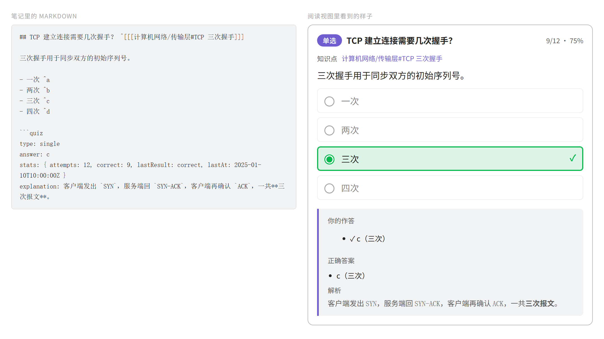

## 从这里开始

| 你想做什么 | 看这里 |
|---|---|
| 让 AI 帮我写题、修题、在讲义里插题 | [AI Skill](#ai-skill) |
| 先跑通一道题 | [快速开始](#快速开始) |
| 挑题型、照着骨架写 | [五种题型与写法](#五种题型与写法) |
| 查字段、锚点、空位规则、降级行为 | [一道题具体怎么写？](#一道题具体怎么写) |
| 在别的笔记里做某一道题 | [怎么在别的笔记里引用一道题？](#怎么在别的笔记里引用一道题) |
| 把题目关联回知识点笔记 | [怎么把题目关联到笔记？](#怎么把题目关联到笔记) |
| 刷完整个题库 | [怎么刷完整个题库？](#怎么刷完整个题库) |
| 作答和成绩存在哪 | [我的作答记录去哪了？](#我的作答记录去哪了) |
| 有哪些命令、怎么设置 | [插件还能帮我做什么？](#插件还能帮我做什么)、[设置](#设置) |
| 最近更新了什么 | [更新内容](#更新内容) |

## AI Skill

仓库自带一份写给 AI agent 的出题规范：[`skills/easyquiz-authoring/SKILL.md`](skills/easyquiz-authoring/SKILL.md)。它不是提示词模板，而是这个插件的作者手册：题面标题与知识点链接的约定、五种题型的骨架、锚点与空位规则、插件写入的字段、降级条件，以及 `question` / `distractors` 该在什么时候用。规范里的每个骨架都会被 `npm test` 交给真正的解析器和判分器跑一遍，所以照着它写出来的题保证可作答。

**什么时候用**

- 给一篇笔记批量补题：让 AI 读知识点笔记，按题型出题并写进新文件。
- 修一份旧题库：按 SKILL 检查不可作答、记录错位的题，给出逐条修法。
- 在讲义、复习页里插入单题：告诉 AI 用 `question` 字段写完整题干，直接把题写进那篇笔记；该笔记要算作题库（`quiz: true`、`#quiz` 标签或命中路径通配符）才会渲染成题卡。

**怎么用**

1. 把 `skills/easyquiz-authoring/` 放到 AI 能读到的位置（例如 vault 里的 `.agents/skills/`，或直接让 agent 读仓库里的这个路径）。
2. 先让 agent 读 `SKILL.md` 再动笔，并说清楚范围：只插单题，还是整份题库；能不能改已有内容。
3. 写完后用命令**校验当前题库文件**，或者直接看题卡是否可作答；有疑问就运行 `npm test`，规范里的骨架会被执行。

**给 AI 的两条硬规则**（与 SKILL 一致）

- **向已有笔记插入单题**时，鼓励用 `question` 覆盖显示的题面、用 `distractors` 追加干扰项；**批量生成题库文件**时，除非用户明确要求，否则不要写这两个字段。
- 题面正文只写当前题型需要的那一段：选择题的选项列表、配对题的数据表、填空题带空位的句子、问答题的正文。更远的段不会显示，紧贴选项或表格的说明会作为「补充内容」出现。

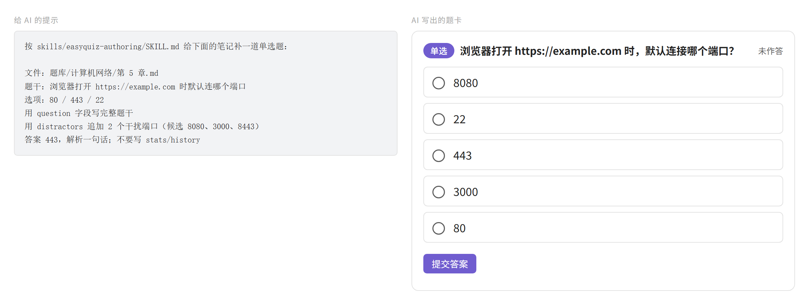

## 快速开始

1. 安装插件（见[安装到 vault](#安装到-vault)）并启用它。
2. 新建一篇笔记，用 frontmatter 给它勾上 **quiz**，然后写一道题：

   ````markdown
   ---
   quiz: true
   ---

   ## TCP 建立连接需要几次握手？ ^[[[计算机网络/传输层#TCP 三次握手]]]

   - 一次 ^a
   - 两次 ^b
   - 三次 ^c
   - 四次 ^d

   ```quiz
   id: tcp-handshake
   type: single
   answer: c
   ```
   ````

3. 切换到阅读视图：`quiz` 数据块会变成一张题卡。作答并提交，记录会写回笔记。

   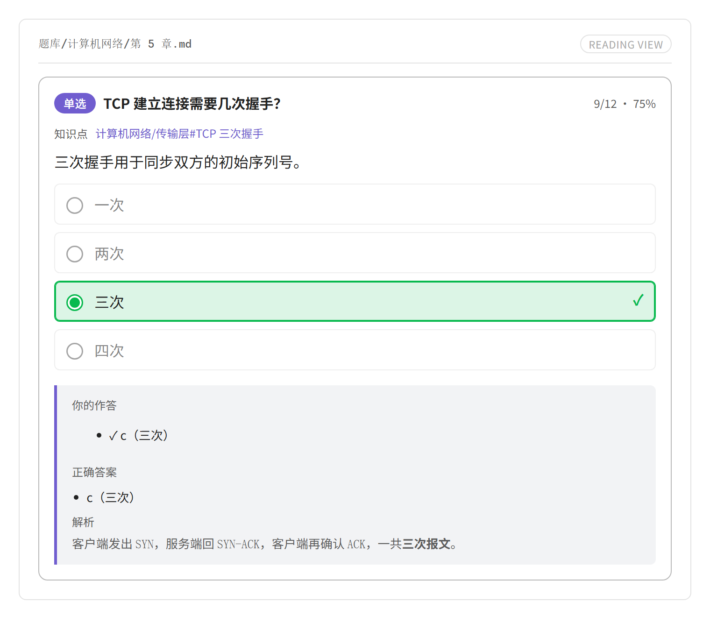

4. 在命令面板里运行**打开刷题窗口**（或点击丝带图标），即可刷完整个题库，也可以一次刷多个题库。

整套流程到此为止。下面每个小节只回答一个问题，按需要挑着看。

## 五种题型与写法

> 出题的最短路径：选 `type` → 写题面正文（列表 / 表格 / `==空位==` / 自由正文）→ 在题目末尾放 `quiz` 数据块 → 在标题末尾挂 `^[[[知识点]]]`。下面每种题型都给可复制的骨架；字段、锚点与降级规则见[一道题具体怎么写？](#一道题具体怎么写)。

五种，而且题型**永远**由 `type` 字段决定——**绝不根据内容形态去猜**。挑一种即可：

| 题型 | 你写什么 | 题卡上做什么 |
|---|---|---|
| `single` 单选 | 一个 Markdown 列表，一个正确锚点 | 点选一个选项 |
| `multi` 多选 | 一个 Markdown 列表，多个正确锚点 | 点选多个选项 |
| `match` 配对 | 一张 Markdown 表格（**行顺序就是答案**） | 点击相邻列建立连线 |
| `blank` 填空 | 正文里的 `==高亮==` | 直接在句子里输入 |
| `essay` 问答 | 自由正文 + 折叠的参考答案 | 书写后自评 |

### 单选

选项就是原生列表。答案绑定的是**锚点**（`^a`）而不是位置，所以自己写了锚点的选项在插入、删除或重排之后，记录仍然不会错位。锚点可以省略：一个都没写时，会按从上到下的顺序自动编号为 `a`、`b`、`c`……，因此 `answer: c` 仍然指第三个选项；只写了一部分时，没写锚点的选项不会出现在题卡里，只有写了锚点的选项能作答。

````markdown
## TCP 建立连接需要几次握手？ ^[[[计算机网络/传输层#TCP 三次握手]]]

- 一次 ^a
- 两次 ^b
- 三次 ^c
- 四次 ^d

```quiz
id: tcp-handshake
type: single
answer: c
explanation: 三次握手用于同步双方的初始序列号。
```
````

提交后，正确选项会被描边，解析直接出现在下面——答案不会藏在另一个地方：


题面、选项和解析都交给 Obsidian 自己的渲染器，所以 `**加粗**`、`` `行内代码` ``、`![[图片.png]]` 内嵌和 `$公式$` 在题卡和刷题窗口里都能正常显示。

题卡用的是 Obsidian 自己的主题变量，所以深浅色主题都成立：

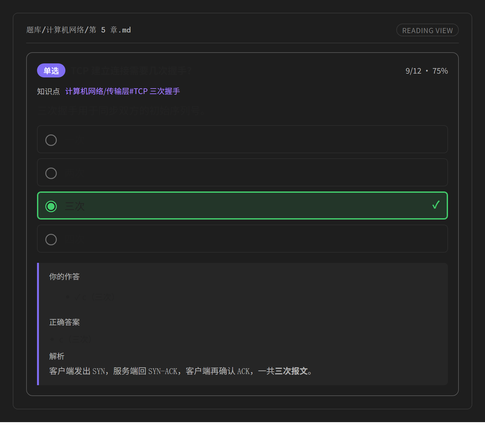

选择题还可以用 `distractors` 追加干扰项（设个数 + 候选池），用 `question` 覆盖显示的题面。下面这张卡两个字段都用上了；干扰项每次作答重新抽取，也不会和你写的选项重复：

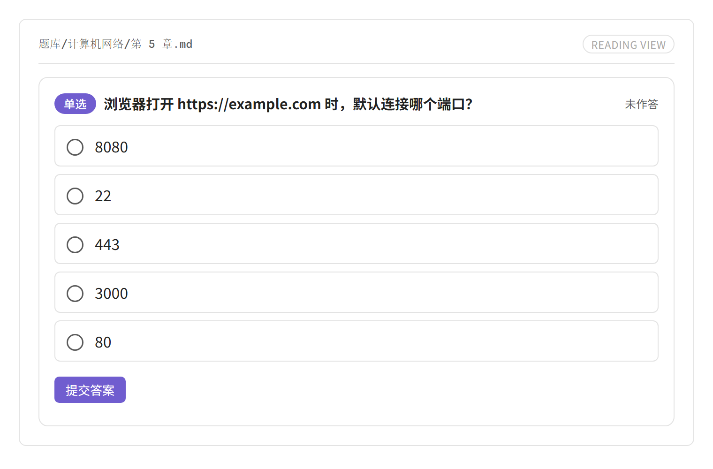

### 多选

形状相同，只是 `answer` 变成列表；锚点规则与单选相同。选对一部分也算错，复盘会把所有正确锚点列出来，方便对照漏了哪个：

````markdown
## 下列哪些属于传输层协议？ ^[[[计算机网络/传输层#传输层协议]]]

- TCP ^a
- UDP ^b
- IP ^c
- ICMP ^d

```quiz
type: multi
answer: [a, b]
shuffle: true
```
````

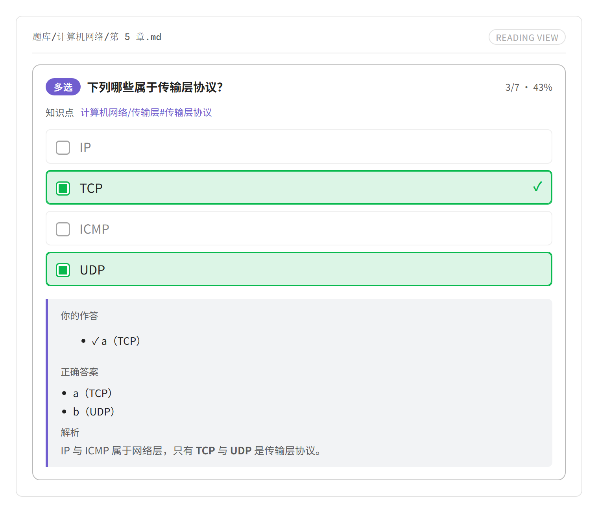

### 配对

写成一张**多列表格**。表格最初的行顺序*就是*正确答案，而刷题时每一列都会独立打乱，所以行顺序永远不会泄露答案。

````markdown
## 将协议与其默认端口配对 ^[[[计算机网络/应用层#常见默认端口]]]

| 协议 | 端口 |
| --- | --- |
| HTTP | 80 |
| HTTPS | 443 |
| SSH | 22 |

```quiz
type: match
```
````

先点左边的条目，再点右边的配对项，两者之间就会画出连线：

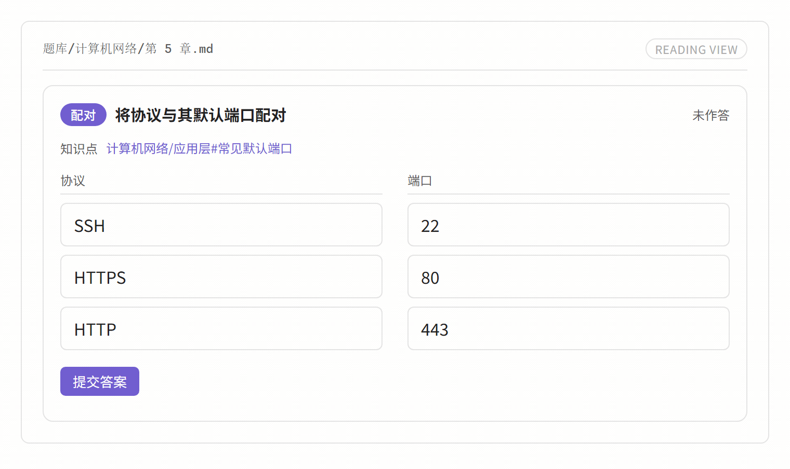

- **只允许相邻列之间连线。** 一行 `A | B | C` 表示 `A–B` 和 `B–C` 两条连线；先点第 1 列再点第 3 列会被拒绝。
- **方向无关**——先左后右和先右后左产生同一条连线。
- **顺序会打乱**，同一列里文字相同的条目会合并。
- **多个条目可以指向同一个条目**（合并选项），例如 `MySQL` 与 `PostgreSQL` 都连到 `关系型`。
- 增加或重排表格行不会让记录失效：条目的键只取决于列号和文字。
- 表格本身不会被渲染——它由连线板替代，所以同一内容不会出现两遍。

### 填空

把答案标在正文里。空位锚点 `^bN` 是**可选的**——不写它，就会按出现顺序自动编号。

````markdown
## 补全 TCP 首部字段 ^[[[计算机网络/传输层#TCP 首部]]]

TCP 首部的最小长度是 ==20== 字节，其中 ==序号== 字段用于标识本报文段数据的第一个字节。

```quiz
type: blank
blanks:
  b1: { accept: ["20", "20字节", "二十"] }
  b2: { ignoreCase: true }
```
````

空位是**内嵌在题干里**渲染的缺口，会随输入内容变宽，所以填空时整句话依然读得通：


提交后，答案会被就地写进缺口：

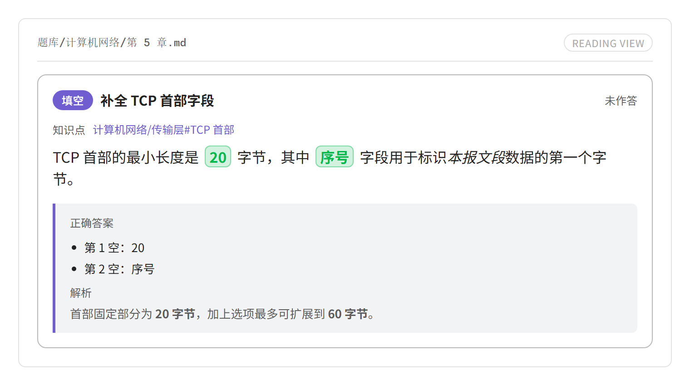

- 标记可配置：`==answer==`（默认）、`**answer**`，或两者都识别。
- 代码块和行内代码里的标记会被忽略，所以你可以在正文里写 `==like this==` 作为示例。
- 没有列在 `blanks` 下的空位使用严格匹配（忽略两侧空白）。
- 提交前，答案文字绝不会出现在题干里。

### 问答

没有固定答案。正文自由书写，参考答案放在**折叠标注**里，以免剧透：

````markdown
## 简述 TCP 与 UDP 的主要区别。 ^[[[计算机网络/传输层#TCP 与 UDP 对比]]]

从连接、可靠性、传输方式与适用场景四个方面作答。

> [!question]- 参考答案
> TCP 面向连接、可靠、字节流；UDP 无连接、不保证可靠、报文边界保留。

```quiz
type: essay
```
````

判分方式是**自评**：写完后标记为已掌握或未掌握。


### 题型写错了会怎样？

不会猜，也不会连累别人。每个问题只把**它自己那道题**降级成一张诊断卡片，指出行号和改法：


| 情况 | 行为 |
|---|---|
| `type` 缺失 | 降级；提示 `type` 为必填 |
| `type` 取值非法 | 降级；列出五个合法取值 |
| `type: single`/`multi` 但没有列表 | 结构不符；不可作答 |
| `type: match` 但没有表格，或列数少于 2 | 结构不符 |
| `type: blank` 但没有 `==…==` | 结构不符 |
| 部分选项没有锚点 | 没锚点的选项从题卡隐藏，其余选项照常作答 |
| 选项锚点重复 | 不可作答 |
| `answer` 指向不存在的锚点 | 不可作答 |
| YAML 解析错误 | 降级；显示原始错误 |

## 一道题具体怎么写？

### 题库文件

只要满足以下任一条，文件就会被当作题库：

1. frontmatter 里的 `quiz: true`（**推荐**——可以保持正文干净）；
2. 文件级的 `#quiz` 标签（frontmatter 标签或行内标签）；
3. 配置的路径通配符命中（例如 `题库/**`）。

````markdown
---
quiz: true
schemaVersion: 1
title: 计算机网络 · 第三章
tags:
  - quiz/net
---

# 计算机网络 · 第三章
````

### 一道题的构成

- 一道题的范围从它的题面标题开始，到**下一个同级或更高级别的标题**为止。
- 标题文字就是题目标题；在末尾写 `^[[[]]]` 可以记录来源知识点。
- `quiz` 数据块是**必填**的：题型来自它的 `type` 字段。
- 把数据块放在题目末尾，或者紧跟在标题之后——两者等价。

**题面识别方式。** 默认是**固定层级**：只有设置里选的那一级标题算题目（默认 H2），每个文件建议只用一种层级。改成**自动**后，凡是自己这一段里有 `quiz` 数据块的标题都算题目——文档里可以混用 H2 分组标题和 H3 题目。自动模式下，一道题的范围到下一个**自己也有数据块**的标题为止；中间没有数据块的更深标题留在上一题里当子标题。

**题卡显示什么。** 题卡从各题型的**目标段**开始向上取题面（连续的非空行算一段）：

- 目标段：选择题是最近一个选项列表；配对题是最近一个表格；填空题是最近一个带空位的段；问答题是最后一段。
- 向上取：紧邻目标段的一段属于题面；再往上只有**紧贴表格**的空行（表格语法需要的强制空行）才继续跨过，遇到普通空行就停下。表格上方和下方的段也按这条规则并入题面，所以表格可以和它的说明文字一起显示。
- 选择题：目标段里列表以外的文字（贴着选项上方的说明）作为「补充内容」显示在题面下方，这时不再向上取普通段；目标段里的表格属于题目内容，会保留在题面或补充内容里。
- 配对题：只识别**最近的一张表**作为配对结构；上面的表格和文字按普通内容处理，作为题面显示。最后一张表下面的文字是补充内容。
- 填空题：目标段连同按上述规则取到的表格与文字都是题面。
- 问答题：最后一段。如果是参考答案 callout，callout 和上面的段一起显示（按上面的规则向上取，表格的强制空行同样越过），答案不会丢。

题面按 Obsidian 的 Markdown 规则渲染；表格前后会自动补上空行，保证答题页与笔记预览里显示一致。题面里会渲染表格、引用、代码等 Markdown 内容，只有选项列表（选择）、配对表格（配对）和空位（填空）由交互控件接管。更上面的段不会显示，避免把上一题的内容带进来。标题太短、想把题面换成完整句子时，用数据块里的 `question` 字段（见下）。

### 元数据字段

| 字段 | 必填 | 说明 |
|---|---|---|
| `type` | **是** | `single` / `multi` / `match` / `blank` / `essay`。决定题型的*唯一*依据。 |
| `id` | 否 | 稳定标识符；省略时由标题文字推导（不含 `^[[[]]]` 知识点链接）。 |
| `question` | 否 | 代替标题显示在题卡上的题面文字；标题仍用于生成 `id` 与知识点链接。 |
| `distractors` | 否 | 只用于选择题：`distractors: 2` 随机追加 2 个干扰项；`distractors: { count: 2, pool: [ ... ] }` 指定候选池。每次作答后重新抽取，复盘时显示作答当时那一组。 |
| `answer` | 视题型而定 | `single`：`c`；`multi`：`[a, b]`；`blank` 与 `match` 与 `essay`：不使用。 |
| `blanks` | 否 | 每个空位的匹配规则：`strict` / `ignoreCase` / `regex` / `accept`。键是空位锚点。 |
| `shuffle` | 否 | 打乱**这道题**的选项顺序。默认 `false`；`match` 始终打乱。 |
| `explanation` | 否 | 解析文字，按 Markdown 渲染（加粗、行内代码、图片、公式都可以）。也可以写成行内的 `> [!note]- 解析` 标注。 |
| `score` | 否 | 分值，默认 1。 |
| `stats` | 否 | **由插件写入**：`attempts` / `correct` / `lastResult` / `lastAt`。 |
| `rev` | 否 | **由插件写入**：题干哈希，用于检测改动。 |

`stats` 和 `rev` 由插件自动维护——**作者从不写它们**。

`question` 和 `distractors` 建议只在**向已有笔记里插入单题**时使用。批量生成整个题库文件时，除非你明确要求，否则不要写这两个字段：题库里的题面应当留在标题上，干扰项也会让批量内容变得难以校对。

### 锚点

选择题选项和空位使用 Obsidian 原生的块 ID 语法 `^id`，因此答案绑定的是锚点而不是位置：

````markdown
- A option ^a
- B option ^b

The minimum TCP header length is ==20== ^b1 bytes.
````

选择题选项的锚点可以省略：一个都没写时按位置自动编号为 `a`、`b`、`c`……；只写了一部分时，没写锚点的选项会从题卡隐藏。如果选项可能被重排、记录又必须跟着同一个选项走，就写显式锚点。

配对表格**不**使用锚点：表格单元格里的 `^id` 会被当作普通文字，行级锚点也不支持。配对题的记录以行内容哈希加行号作为键，所以修改表格只会把受影响的记录标记为「题面已变更」，而不会悄悄丢弃它们。

### 配对题细节

- 只有 `type: match` 时表格才会被当作配对题；其他题型里的表格只是普通正文，不参与判分。
- **一个条目在一对相邻列之间可以连多条线。** 点击已经连上的那一对会删掉这条线，所以改连要先删掉旧线。
- 点击一个已连线的条目只是选中它，不会悄悄去掉它的连线。
- **重复条目会合并**：同一列里文字相同的条目只出现一次。
- 表头重复或为空的列会得到可区分的名字（例如 `层级（第 2 组）`）。
- **多列**会沿表格依次串联，所有相邻列对都必须配对：

  ````markdown
  | 协议 | 端口 | 层级 |
  | --- | --- | --- |
  | HTTP | 80 | 应用层 |
  | IP | 0 | 网络层 |
  ````

- **一个单元格就是一个条目**：单元格里的文字原样保留，所以 `MySQL / PostgreSQL` 是一个名为
  `MySQL / PostgreSQL` 的条目，不会被拆成两个。要让一个条目对多个条目负责，就重复写这一行——
  文字相同的条目会合并成一个节点，而它会保留自己需要的每一条连线：

  ````markdown
  | 数据库 | 类型 |
  | --- | --- |
  | MySQL | 关系型 |
  | PostgreSQL | 关系型 |
  | Redis | 键值型 |
  ````

  这样第一列会得到 `MySQL`、`PostgreSQL`、`Redis`，第二列会得到 `关系型`、`键值型`。`关系型`
  只出现一次，但它挂着两条线，分别连到 `MySQL` 和 `PostgreSQL`。
- 表格至少需要 2 列，否则该题会降级并给出提示。

### 空位匹配规则

- 每个被标记的片段就是一个空位；空位数量由题目正文决定。
- 只有在需要从 `blanks` 引用某个空位时才写显式锚点：

  ````markdown
  最小长度是 ==20== ^len 字节。
  ````

- 没写出的锚点会按位置编号为 `b1`、`b2`、…；同一道题里混用显式锚点和自动编号是可以的。

## 怎么把题目关联到笔记？

在题面标题末尾写 `^[[[]]]`——`^[`、一个 Obsidian 双向链接、`]`：

```markdown
## TCP 建立连接需要几次握手？ ^[[[计算机网络/传输层#TCP 三次握手]]]
```

- `^[ … ]` 这层包装把链接标成题干的注记，而不是普通题目文字；里面的 `[[…]]` 是真正的双向链接：会渲染成链接，题库笔记也会出现在目标笔记的反向链接面板里——在题卡上就是那一行**知识点**。
- 解析器会**把它从显示的标题和推导出的 id 中剥离**，因此重新指向链接永远不会让已累积的 `stats` / `history` 失联。链接目标可通过 `QuizQuestion.knowledgeLink` 取得。
- `rev`（题干哈希）由题干正文计算，而不是标题，因此**重新链接一道题不会把它的记录标记为「题面已变更」**。
- 只有位于末尾的 `^[[[]]]` 才算数。旧的两对方括号写法 `^[[…]]` 仍然被识别。想在题目文字里放行内链接时，就在题干正文里写普通的 `[[]]`；只有标题上的链接会被剥离。
- 链接是可选的——没有链接的题目只是 `knowledgeLink: null`。

完整的出题规范（包括五种题型与检查清单）见 [`skills/easyquiz-authoring/SKILL.md`](skills/easyquiz-authoring/SKILL.md)。它是写给编写或审阅题库的 AI agent 看的，其中的示例会被测试套件执行，所以文档里给出的骨架保证能解析通过。

## 怎么在别的笔记里引用一道题？

在题库文件里给题目写一个 `id`（不写时由题面标题推导，建议显式写），然后在任意笔记里用**内联代码**写这个 id：

```markdown
本周复习：`tcp-handshake`
```

题目会**就地渲染成一张真正能作答的题卡**；点题卡右上角的铅笔，就回到它所在的题库笔记并定位到题面。

- 只有**整段内联代码就是一个 id** 时才算引用；普通代码片段、围栏代码块、标题里的代码都不会被接管。
- id 在整个 vault 里唯一时直接定位；重名时优先当前笔记里的那一道题，仍然无法唯一确定就保持代码原样。
- 同一段文字里可以写多道题；引用本身不参与判分，作答记录仍写回题目所属的题库。
- 适合把题目拼进复习页、讲义或模拟卷，不必复制题目文字。

插件**不接管任何 `![[...]]` 嵌入**：`![[图片.png]]`、`![[某笔记#某一节]]` 都保持 Obsidian 原本的渲染。`![[题库#题面标题]]` 也会按原生方式显示该小节（题面、选项与数据块原文），不会变成题卡。

## 怎么刷完整个题库？

**打开刷题窗口**（或丝带图标）会在右侧边栏打开一个三页的窗口，整轮刷题都不用离开它。同一个窗口也可以开在主区域的新标签页或独立窗口里——命令面板里有**在新标签页打开刷题窗口**与**在新窗口打开刷题窗口**。每个位置各保留一个窗口，因此侧边栏一轮、标签页一轮可以同时进行。

### 1. 题库列表

vault 里的每个题库文件，按文件夹分组，每一行都带着它的数据：题目总数、可作答数、需修正数、各题型数量、作答次数、正确率，以及最近一次作答的日期。解析失败的文件会报告自己的错误，不会破坏整个列表。

文件一多，这一页提供三种收敛方式：

- **搜索**——按文件名或路径过滤，输入即生效，并显示**匹配到几份**。搜索不会动你已经勾好的选择。
- **折叠文件夹**——点文件夹标题即可收起或展开该组；**全部折叠** / **全部展开**一次处理所有分组。折叠状态会跟着工作区一起保存。
- **整组勾选**——每个文件夹标题右侧都有一个勾选框，整组勾上或取消；组内只有部分被选中时显示为半勾。

勾选一个或多个文件——或者点**全选可作答**（作用于当前搜索结果）——就能放在一起刷：

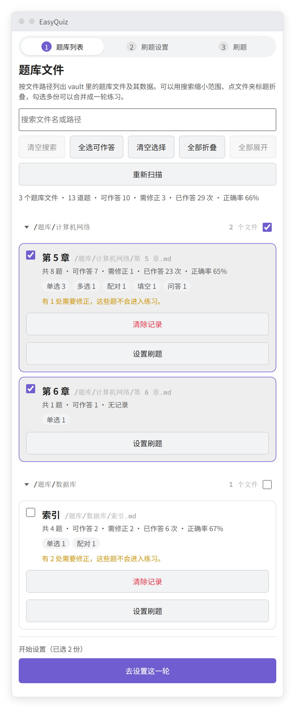

### 2. 刷题设置

决定这一轮怎么抽题，并且在开始前就能看到**实际会刷多少道**：

- **顺序刷题**——按文件顺序取全部候选题。
- **定量随机抽题**——打乱后取 N 道（填 0 或留空表示全部）。
- **只刷错题**——只保留上次作答错误的题。
- **题型**——任意子集；一个都不勾表示不限题型。
- **打乱顺序**——打乱出题顺序与选择题的选项顺序。选项顺序由这一轮的种子推出来，因此复盘答案、上一题/下一题来回切时都不会跳位，只有重新开始一轮才会重洗。判分按锚点，所以选项换位不会改变什么算对。

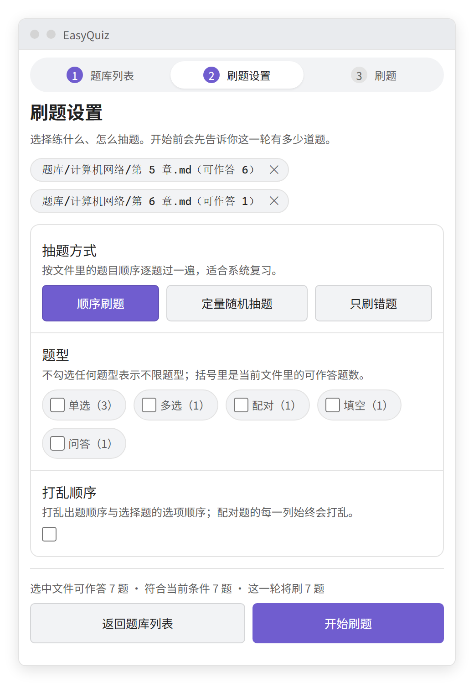

降级题永远不会进入任何一轮，所以一道坏题不会悄悄占掉一个名额。

### 3. 刷题

一次一道题，用与笔记里相同的题卡界面渲染，带吸顶的进度条、对错计数、上一题/下一题（轮次较长时还有跳转框）。提交通过同一个服务判分，因此记录会和阅读视图里一样写回：

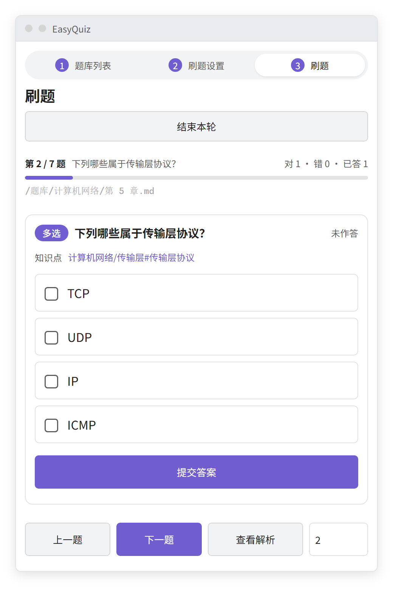

- **查看解析**会在不判分的情况下揭示答案。
- 右上角的**编辑**按钮跳到题目所在笔记：像点反向链接一样跳到题目的标题：编辑视图把光标放到标题上，阅读视图滚动到标题并高亮；笔记已经打开时切到原来的标签页。
- 刷题页导航右侧的**清除本题记录**只清掉当前这道题的作答次数与历史；题库列表每行的**清除记录**清掉整个题库。两处都需要再点一次确认。
- 最后一页汇总本轮结果，列出答错的题，并提供**只重做错题**。

作答以文件路径 + 题目 id 作为键，所以即使文件被编辑，一轮刷题也不会错乱：题库文件变化时窗口会重新解析，每次写回之后也会再解析一次。命令面板里的**刷这个题库**可以直接对当前打开（或文件浏览器里选中的）题库开始一轮。

## 我的作答记录去哪了？

一切都写进题目自己的 `quiz` 数据块里，因此记录会跟着笔记一起走：

```yaml
type: single
answer: c
stats: { attempts: 12, correct: 9, lastResult: correct, lastAt: 2025-01-01T10:00:00Z }
rev: 8f3c1a
history:
  - { at: 2025-01-01T10:00:00Z, result: correct, ms: 4200 }
  - { at: 2025-01-01T09:58:11Z, result: wrong, answer: ["b"], ms: 6100 }
```

- `stats` 是永不截断的汇总，正确率之类的数字由它得出。
- `history` 受上面设置的上限约束；超出时先丢弃最早的条目。

写回规则：

1. 只改动 `stats`、`history` 和 `rev`——其他内容逐字节保留。
2. 写入通过 `Vault.process`（原子的读—改—写）完成；数据块会从最新的文件内容里重新定位，因此这期间的编辑不会被覆盖。
3. 打好补丁的数据块会先重新按 YAML 校验；校验失败就跳过这次写入，而不是冒着写坏笔记的风险。

### 已知限制

| 限制 | 影响 | 应对 |
|---|---|---|
| 每次作答都会重写笔记 | 用 Git 的用户会看到 `git status` 频繁变动；Sync 可能产生冲突 | 可以在设置里关闭写回 |
| 明细列表必须有上限 | 不会保留完整的作答历史 | `stats` 从不截断；调高上限即可 |
| 笔记位于不可写的 vault 中 | 记录无法持久化 | 作答仍然在界面上判分 |

## 界面能用中英哪种语言？

都能——界面提供**英文和中文**两种。不需要安装额外的翻译文件：两张文案表都打包在插件里，插件加载时二选一，修改设置的那一刻也会重新选择。

- **跟随 Obsidian**（默认）会读取 Obsidian 自己的语言，是中文变体（`zh`、`zh-CN`、`zh-TW`、…）时使用中文，其他情况使用英文。
- **界面语言**设置可以覆盖这个选择。
- 切换语言会立即重渲染刷题窗口、设置页，以及阅读视图里已经打开的题卡。命令面板里的命令名和丝带图标的悬停提示是在插件加载时注册的，所以要**重新加载**后才会变化。
- 题目**内容**永远不会被翻译：用中文写的题就保持中文，`explanation`、选项文字以及笔记里的其他一切也都一样。只有界面文字跟随语言设置。

## 插件还能帮我做什么？

| 命令 | 作用 |
|---|---|
| 打开刷题窗口 | 在右侧边栏打开刷题窗口（丝带图标同样可以） |
| 在新标签页打开刷题窗口 | 把刷题窗口开成主区域的标签页 |
| 在新窗口打开刷题窗口 | 把刷题窗口开成独立窗口（仅桌面端） |
| 插入题目 | 打开对话框生成题目骨架并插入到光标处 |
| 刷这个题库 | 对当前打开的题库文件直接开始一轮（文件浏览器菜单里也有同样入口） |
| 校验当前题库文件 | 报告有多少题可作答、多少题需要修正 |
| 刷新题库视图 | 强制阅读视图重新渲染 `quiz` 数据块（编辑后也会自动触发） |

插入对话框也可以从编辑器右键菜单打开（**右键 → 插入题目**，仅限 Markdown 笔记）。它只询问题型和题干标题，写入前会先预览 Markdown，并且跟随界面语言——所以中文界面插入的是中文骨架：

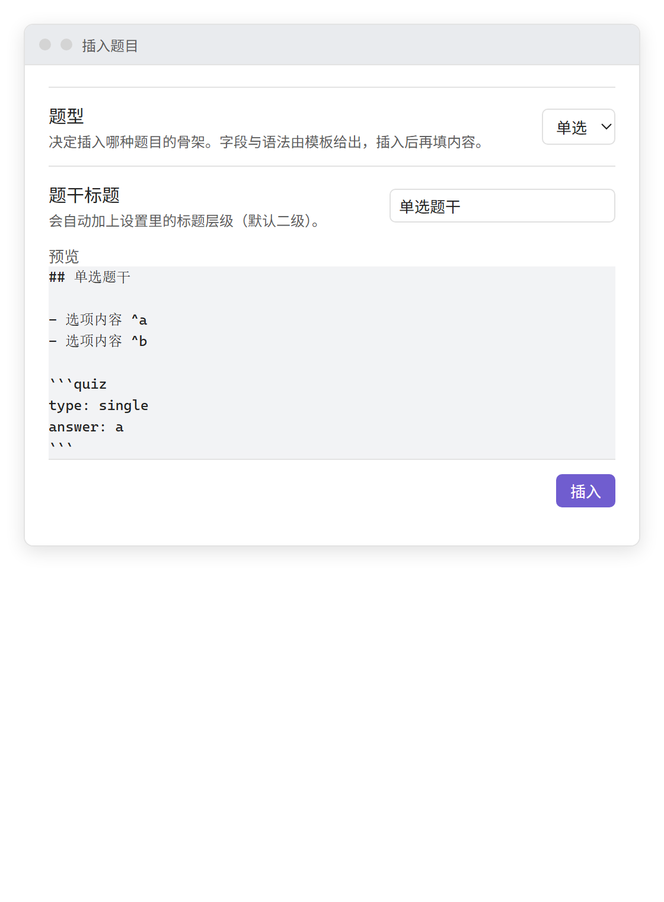

题库文件还可以从**文件浏览器**里直接开刷：在文件列表或文件树里点题库文件右侧的 **⋯ → 刷这个题库**，刷题窗口会打开并**直接停在这个题库的刷题设置页**——省掉"打开窗口、再在列表里找它"这两步。菜单项只对 Markdown 题库文件出现，多选或非题库文件时不会打扰你。

## 设置

| 设置 | 默认值 | 说明 |
|---|---|---|
| 界面语言 | 跟随 Obsidian | `跟随 Obsidian`、`English` 或 `中文` |
| 数据块语言 | `quiz` | 如果与别的插件冲突就改掉；改后需要重新加载 Obsidian |
| 填空标记 | `==` | 用哪种 Markdown 标记表示空位：`==answer==`、`**answer**`，或两者都识别 |
| 题面标题层级 | H2 | **固定层级**模式下，决定哪些标题被当作一道题；切到**自动**后这一项会隐藏 |
| 题面标题匹配方式 | 固定层级 | **固定层级**：只看选定的标题层级；**自动**：每个拥有 `quiz` 数据块的标题都算一道题，可混用不同层级 |
| 题库路径通配符 | 空 | 每行一条，例如 `题库/**` |
| 记录写回 | 开 | 关闭后只在界面上判分，不修改笔记 |
| 显示「题面已变更」提示 | 开 | 题面结构在记下 `rev` 后发生变化时，在题卡上显示提示；在题卡上点「关闭提示」会直接关掉这个设置 |
| 单题历史条数上限 | 10 | 记录写在笔记内，所以明细列表必须有上限；`0` 表示只保留汇总 |

## 安装到 vault

1. 新建 `<Vault>/.obsidian/plugins/easy-quiz/`。
2. 把 `main.js`、`manifest.json` 和 `styles.css` 复制进去。
3. 重新加载 Obsidian，在**设置 → 第三方插件**下启用该插件。

## 更新内容

### 1.1.4

- **题面标题恢复成普通文本**：标题不再跳转，回源笔记只用右上角的铅笔。
- **回源一定落在题面**：打开题库后会按题目所在行再定位一次，标题带 `^[[[知识点]]]` 也不会停在顶部。
- **题库列表在启动时不再空白**：会等 Obsidian 建好索引并自动重扫。

### 1.1.2

- 不再接管 `![[...]]` 嵌入：图片、笔记小节都按 Obsidian 原生方式渲染；题目引用只用「题目id」内联代码。
- 笔记里的题卡也能回到原题：点标题或右上角的铅笔，直接打开题目所在的题库笔记并定位到题面。

### 1.1.1

- **用题目 id 引用**：在任意笔记里用内联代码写题目 id，题卡就地渲染。
- **编辑按钮跳转更准**：像反向链接一样跳到题目标题——编辑模式光标落在标题行，阅读视图滚动到标题并带原生高亮，已打开的标签页会复用。
- **提示可关**：「题面已变更」提示可以在设置里关闭；在题卡上点「关闭提示」会直接关掉这个设置，所有题卡的警告色一起恢复。
- **导航防误触**：「清除本题记录」移到导航右侧、与跳题输入框同一组。

### 1.1.0（主题：嵌入式编写）

- **AI Skill**：仓库自带 `skills/easyquiz-authoring/SKILL.md`，五种题型的骨架、锚点与降级规则、知识点链接约定都有据可依；AI 照着它批量补题、修题、在讲义里插题，规范里的示例由测试真正解析并判分。
- **嵌入式编写**：数据块新增 `question` 覆盖题面、`distractors` 追加干扰项（可设个数与候选池，每次作答重抽）；题卡右上角新增**编辑**按钮，按原生内链跳到源笔记里的题目并高亮定位，笔记已打开时复用标签页；`![[题库#题面]]` 在别的笔记里就地渲染成可作答的题卡。
- **题面识别**：标题可以设为**自动**匹配——凡是自己这一段里有 `quiz` 数据块的最近标题都算一道题，不必整篇文件用同一级标题；题面从各题型的**目标段**向上取，紧邻的一段属于题面，再往上只有表格上下的强制空行才继续跨过，普通空行停止；选择题贴选项的说明进入「补充内容」，配对题只识别最近的一张表，问答题的 callout 与上面的段一起显示。
- **按 Obsidian 渲染**：题面与补充内容都带 `markdown-rendered`，表格前后自动补空行，答题页与笔记预览一致；选项、解析、配对单元格也照常渲染 Markdown。
- **刷题与记录**：题库选择页的文件夹支持半选，切回来自动发现文件变化；题目和题库都能清除作答记录；命令面板新增**刷这个题库**；切回已答过的题会显示当时的作答，右上角统计同步更新。
- **干扰项更稳**：每次作答后重新抽取，复盘时看到的是作答当时那一组。

每个版本只会提示一次。更早的版本见 [GitHub Releases](https://github.com/AnkingLin/EasyQuiz/releases)。

## 常见问题

| 现象 | 原因 | 处理 |
|---|---|---|
| `quiz` 数据块显示为普通代码块 | 笔记没有被识别为题库，或者数据块不在任何题面标题之下 | 加上 `quiz: true`，并检查标题层级与**题面标题层级**设置一致 |
| 题卡出现了，但点**提交答案**没有反应 | 该题已降级（数据块上方会显示提示） | 按提示指出的问题修正——通常是 `type`、重复的锚点或 YAML 错误 |
| 编辑题目后屏幕上还留着旧题卡 | 阅读视图不会自己重渲染代码块 | 插件会自动刷新；否则运行**刷新题库视图** |
| 重命名之后记录不再累积 | `id` 是由旧的标题文字推导出来的 | 给这道题写一个显式的 `id`；记录以文件路径 + 题目 id 为键 |
| 某个 `quiz` 数据块被完全忽略 | 它不在任何被当作题目的标题之下 | 把它移到某个题面标题之下 |
| 改了数据块语言后没生效 | 处理器是在插件加载时注册的 | 重新加载 Obsidian |
| 另一个插件的 `quiz` 片段不再渲染 | 本插件占用了 `quiz` 数据块语言 | 在设置里改掉**数据块语言**，然后重新加载 |

## 开发

```bash
npm install
npm run dev        # watch src/main.ts, rebuild main.js on change
npm run build      # tsc type check + production bundle
npm test           # bundle and run the test suite (429 cases)
npm run typecheck  # type check only
npm run lint       # eslint (eslint-plugin-obsidianmd)
npm run assets     # 重新生成两份 README 用到的截图与 GIF
```

测试套件分两层：

- **纯逻辑**（`parser`、`stem`、`reference`、`grade`、`writeback`、`match-board`、`insert`、`session`）：纯 node，无 DOM。
- **DOM**（`tests/quiz-match-dom.test.ts`、`tests/quiz-insert-modal.test.ts`、`tests/quiz-practice-view.test.ts`、`tests/quiz-knowledge-link.test.ts`、`tests/quiz-file-menu.test.ts`、`tests/quiz-i18n.test.ts`）：
  在 jsdom 下通过 `renderQuizCard` 渲染真实的题卡与连线板并点击其节点，因此点击处理、连线目标、各列之间的隔离、`MarkdownRenderer` 契约以及知识点链接都是被验证过的，而不是假设的；插入对话框通过 `InsertQuestionModal` 打开并驱动其控件；刷题窗口通过 `PracticeView` 打开并走完它的全部三个页面——包括列表页的搜索、文件夹折叠与整组勾选；文件浏览器菜单也由它自己的真实事件处理函数驱动。`tests/dom.ts` 安装 Obsidian 风格的 DOM 辅助函数（`createDiv`、`addClass`、…），`tests/obsidian-stub.ts` 则代替只有类型定义的 `obsidian` 包。

`tests/quiz-skill-doc.test.ts` 把文档和代码闭环起来：它读取 `skills/easyquiz-authoring/SKILL.md`，抽出每个被标记的示例，交给真正的解析器与判分器。文档里的骨架如果无法作答，测试套件就会失败。

`tests/quiz-i18n.test.ts` 覆盖另一个方向：两张文案表必须暴露相同的键和相同的 `{placeholders}`，而且英文界面是真正渲染出来的（题卡、解析器提示、刷题窗口），而不只是查表。

### 重新生成 README 里的图片

本文档里的每一张截图和 GIF 都由 `npm run assets` 产出，它在无头浏览器里跑插件的真实代码：

- `tools/readme-assets/browser/fixtures.ts` 里的夹具交给真正的 `parseQuizFile` 解析；
- 题卡由真正的 `renderQuizCard` 渲染，窗口由真正的 `PracticeView` 渲染，对话框由真正的 `InsertQuestionModal` 渲染；
- 样式来自插件自己的 `styles.css`，外面套一层对 Obsidian 默认主题的近似实现（`tools/readme-assets/theme.css`）。

所以这些图是渲染器的真实输出，但有一个必须说清楚的边界：它们**不是真实 Obsidian 窗口的截屏**。周围的窗口外框、笔记标题栏都是搭出来的壳，GIF 也是生成器驱动真实点击/输入事件后合成的帧序列，而不是录屏。产物写在 `docs/assets/<en|zh>/` 下，因此两份 README 各自展示自己语言的界面。

### 源码结构

```
src/main.ts          plugin entry: code-block processor, commands, view registration, settings tab
src/parser.ts        question-bank parser (pure logic, no obsidian import)
src/types.ts         question model and parse-result types
src/stem.ts          stem preprocessing: strips what the interactive controls render (pure logic)
src/reference.ts     题目 id 引用：内联代码 id 解析、题库索引、唯一匹配规则（纯逻辑）
src/plain-text.ts    display-only plain text for option/answer text in review notes (pure logic)
src/grade.ts         grading for the five question types (pure logic)
src/writeback.ts     record write-back: only stats/history/rev, validated before writing
src/hash.ts          stem hash (rev change detection)
src/match-board.ts   matching board state machine: adjacent-column links (pure logic)
src/session.ts       practice planning: file summaries, filtering, sampling, progress (pure logic)
src/runtime.ts       Obsidian adapter: file detection, dependency injection, atomic writes
src/view.ts          practice card rendering (including the header's knowledge-point link)
src/practice-view.ts practice window: question-bank list / practice settings / practice
src/source-note.ts   回到题面所在的笔记：标题链接与按行定位（Obsidian 适配层）
src/whats-new.ts     update notes by version and the upgrade check (pure logic)
src/whats-new-modal.ts the one-time What's new dialog
src/insert.ts        question templates and insertion positioning (pure logic)
src/insert-modal.ts  insert-question dialog and the editor write
src/file-menu.ts     the file explorer menu entry that starts practising a bank
src/labels.ts        question-type labels and default stem titles, shared by card/dialog/window (pure logic)
src/i18n/            English/Chinese message tables and the language state (pure logic)
skills/              agent-facing authoring spec (SKILL.md), examples verified by the test suite
tests/               parser / stem / grading / write-back / insert / session tests, the window tests, a fixture
tools/readme-assets/ README 截图与 GIF 生成器（见上一节）
```

`parser` / `stem` / `reference` / `plain-text` / `grade` / `writeback` / `hash` / `match-board` / `insert` / `session` / `labels` / `i18n` 刻意**不**导入 `obsidian`，因此它们可以在纯 Node 下运行；所有对 Obsidian API 的依赖都限制在 `runtime.ts`、`view.ts`、`practice-view.ts`、`source-note.ts`、`insert-modal.ts` 和 `file-menu.ts` 里。文案表也是如此：它们是普通对象，所以解析器不必接触 Obsidian API 就能产生本地化的提示。

题干渲染时会**去掉**那些有自己交互控件的部分——选项列表、配对表格以及 `==answer==` 文本都会被剥离，以免同一内容显示两遍。

## 状态

已实现并有测试覆盖：解析器、题干预处理、五种题型的判分、记录写回、连线板逻辑、题目模板及其插入定位、题卡界面（题面、选项、解析与配对单元格都按 Markdown 渲染、可点击连线的多列配对及打乱、内嵌的点击输入式空位及其随内容变宽、问答题自评，以及可点击的知识点链接）、刷题窗口（带逐文件数据的题库列表，外加搜索、文件夹折叠与整组勾选；带题型/抽题筛选与「打乱顺序」的刷题设置；以及一次一道题、在原处揭示答案并给出最终报告的一轮）、「题目 id」引用（在别的笔记里就地渲染成可作答的题卡，右上角的铅笔可回到题库笔记），从文件浏览器菜单直接跳到某个题库刷题设置的入口，还有带语言设置的英文/中文界面。题库文件被修改会触发防抖的阅读视图刷新，并使窗口缓存的解析结果失效。

尚未实现：把多次写回合并成一次文件写入，以及跨轮次的统计（错题本、图表）——目前只有窗口为单轮计算出的那些数据。

> 题卡界面、插入对话框、写回和刷题窗口都**尚未**在真实的 Obsidian 实例里验证过。逻辑层（解析、题干预处理、判分、写回、模板生成、插入定位和轮次规划）有完整测试，窗口的三个页面也在 jsdom 下跑过，但 DOM 行为——列与列之间的连线渲染、填空输入框的焦点处理、阅读模式的重渲染、对话框在真实弹窗里的渲染方式，以及侧边栏视图在真实工作区中的布局——只能在 Obsidian 里手工确认。上面这些图片由同一份真实渲染代码在无头浏览器里生成，缩小了这个差距，但并没有消除它。

## 参与贡献

- `main.ts` 只保留插件生命周期；功能逻辑放在 `src/` 下各自独立的模块里。
- `parser` / `stem` / `reference` / `plain-text` / `grade` / `writeback` / `hash` / `match-board` / `insert` / `session` / `labels` / `i18n` 不得导入 `obsidian`，这样它们才能在纯 Node 下保持可测试。
- 绝不要硬编码界面文案：在 `src/i18n/en.ts` 里加键，在 `src/i18n/zh.ts` 里填写（两张表会互相做类型检查），然后通过 `t()` 读取。两张表里的 `{placeholders}` 要保持一致。
- 改变用户可见的行为时，要同时更新 `README.md`、`README.zh-CN.md` **和** `skills/easyquiz-authoring/SKILL.md`——后者的示例会被 `npm test` 执行。如果改动在界面上看得见，还要运行 `npm run assets`，让图片保持准确；如果希望用户更新后看到提示，还要在两份 README 和 `src/whats-new.ts` 里加上对应的更新条目。
- 提交 PR 之前先运行 `npm run build`、`npm test` 和 `npm run lint`；CI 会跑这三项。

支持的语言：**English**（[README.md](README.md)）和 **中文**（本文件）。

## 许可证

0-BSD，见 [LICENSE](LICENSE)。
